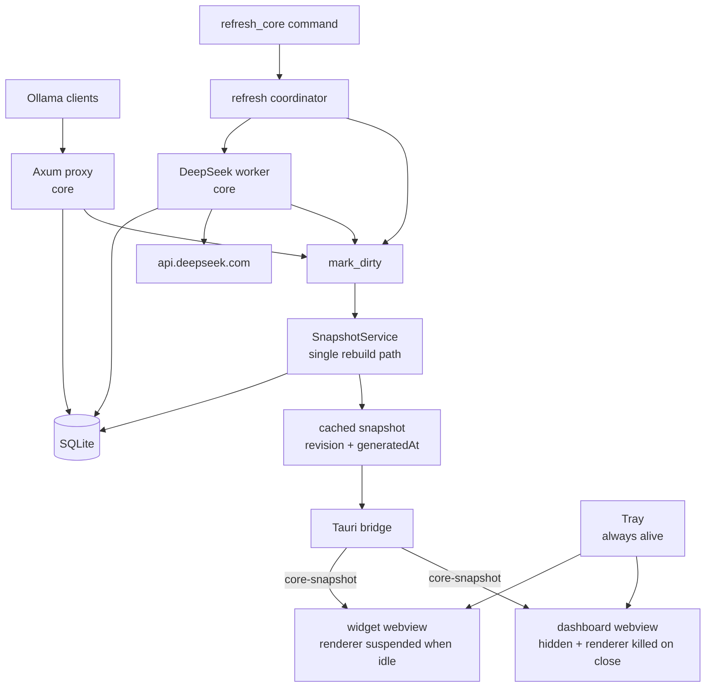

# Architecture

## Overview

TokenFlow is a local-first desktop analytics application that tracks usage of Ollama and DeepSeek large language model services. It runs a loopback Ollama proxy on `127.0.0.1:11435` that captures token counts from streamed responses, and a separate worker polls the DeepSeek balance API periodically. Usage history is stored in a local SQLite database, and DeepSeek API keys are managed via the OS credential store (Keychain on macOS/Windows, Secret Service on Linux). The application is built with Tauri 2, React, and TypeScript, providing a desktop tray and metrics panel for real-time monitoring.

A single always-running Rust core inside the Tauri process owns all data collection, persistence, snapshot building, and refresh coordination. The UI (dashboard and widget windows) is reduced to a renderer: it consumes one core-owned snapshot through a single Tauri event and one unified refresh command. The core keeps running when every window is closed, so the proxy stays live with no webview **renderer process** in memory. On Linux the window shells are kept hidden and their renderers are killed on close; other platforms destroy and recreate the windows. See [docs/perf/webkit-memory-research.md](docs/perf/webkit-memory-research.md) for why.

## System context

TokenFlow operates entirely on the user's desktop with no cloud dependency for core functionality. The Ollama proxy runs on loopback only (`127.0.0.1:11435`), forwarding requests unchanged to the user's Ollama server on `127.0.0.1:11434`. DeepSeek balance polling targets `api.deepseek.com` over HTTPS. All data remains on the local machine; no usage data is transmitted to external services except the necessary API calls to Ollama and DeepSeek for real-time tracking.

A Mermaid diagram illustrates the system architecture:



## Ownership model

The core owns all data collection and querying; the UI is a pure renderer. The only UI-facing data path is: an initial `get_core_snapshot` call, `core-snapshot` events, and one `refresh_core` command.

| Concern | Owner | Never in UI |
|---|---|---|
| Token capture | `proxy.rs` | — |
| Balance polling | `deepseek.rs` | — |
| Persistence | `db.rs` | — |
| Snapshot aggregation | `snapshot.rs` | SQL/query logic |
| Rebuild scheduling | `snapshot.rs` | timers |
| Manual refresh | `commands::refresh_core` | direct provider calls |
| Model cleanup | `commands::delete_model_data`, `commands::merge_models` | direct `DELETE`/`UPDATE` SQL |
| Model catalog | `commands::get_model_catalog` | SQL/query logic |
| Window lifecycle | `windows.rs` | — |
| Rendering | `App.tsx`, `Widget.tsx` | — |

## Components

- **Desktop shell**: Tauri 2 with two-action native tray menu on Windows/macOS, icon-only StatusNotifierItem on Linux, and two windows (`main` dashboard, `widget` panel) that are created on demand and never at autostart. On Linux a window is created once and reused (hide, kill its renderer, reload on reveal); see [Window and renderer lifecycle](#window-and-renderer-lifecycle).
- **Snapshot service**: `snapshot.rs` — the single core-owned rebuild path. Owns the only `Db::snapshot()` call, a cached `Arc<DashboardSummary>`, a monotonic `revision`, and a `Notify`-driven scheduler with 400ms debounce and a 60s day-rollover heartbeat. No Tauri types inside the service; `spawn_bridge` is the only Tauri-facing code.
- **Memory hygiene**: `memory.rs` — a 15-minute idle tick that clears the WebKit resource cache and releases glibc free pages, but only while every window is hidden. `recycle.rs` — Linux-only idle re-exec that returns the core to its pre-webview footprint after `idle_recycle_secs` (default 60). `heap_stats.rs` (cargo feature `heap-stats`) — optional counting allocator that logs core heap counters every 60s.
- **Refresh coordinator**: `RefreshCoordinator` in `state.rs` — an async `Mutex` plus a `last_refresh_at` atomic. Both the DeepSeek worker and `refresh_core` acquire it, so double-clicks and two open windows produce one network call, not two.
- **Proxy**: Axum 0.7 running on loopback only, with hop-by-hop header filtering and a 64 MiB request body cap.
- **Stream parser**: Buffered NDJSON + SSE parser that handles input/output/cached token split, flushes complete lines only, and deduplicates by request ID.
- **Storage**: `rusqlite` (bundled SQLite) in WAL mode with embedded migrations, indexed queries, and deduplication via unique `request_id` index.
- **DeepSeek worker**: `reqwest` + rustls polling every 15 minutes by default, storing one row per currency with success and error timestamps.
- **Frontend**: React 18, TypeScript, Vite, Tailwind CSS, Framer Motion. Both windows consume the core snapshot through the `useCoreSnapshot` hook.
- **Events**: A single `core-snapshot` Tauri event carries the full `DashboardSummary`. No UI-facing polling; freshness comes from core-pushed events plus a `sync()` catch-up on window reveal.

## Snapshot contract

The core owns one fixed-range snapshot. There is no per-window range parameter; both the dashboard and the widget render the same `DashboardSummary`.

```rust
pub struct DashboardSummary {
    pub revision: u64,        // monotonic; increments on every rebuild
    pub generated_at: i64,    // Unix seconds
    pub range_days: u32,      // always SNAPSHOT_RANGE_DAYS (30)
    pub totals: Totals,
    pub streak_days: u32,
    pub models: Vec<ModelUsage>,
    pub daily: Vec<DailyUsage>,
    pub recent: Vec<OllamaLog>,
    pub latest_balance: Option<BalanceSnapshot>,
    pub proxy: ProxyStatus,
}
```

The `useCoreSnapshot` hook registers the `core-snapshot` listener before the initial fetch, applies only snapshots whose `revision` is strictly newer than the current one (discarding stale out-of-order events and the duplicate that arrives when a manual refresh's invoke response and event carry the same revision), and buffers updates while the window is hidden so a reveal is instant and current. Before handing a snapshot to React it reconciles unchanged slices (`totals`, `models`, `daily`, `recent`, `latest_balance`, `proxy`) to their previous references, so `React.memo` on the dashboard cards skips work when only one slice changed. There are no `setInterval` calls anywhere in the UI; a `sync()` catch-up runs on reveal and on window focus (a minimized window is skipped by the core bridge and catches up when restored).

## Window and renderer lifecycle

Windows are created on demand (`windows.rs::ensure_window`, serialized by
`window_lock`) and never at autostart. After that the lifecycle differs by
platform because WebKitGTK's webview teardown is unreliable; see the
[research note](docs/perf/webkit-memory-research.md).

| Action | Linux (WebKitGTK) | Windows / macOS |
|---|---|---|
| Close dashboard (`close_to_tray`) | hide, `terminate_web_process`, mark suspended; window and webview kept | destroy the window |
| Reopen dashboard | `load_uri(last_uri)` (fallback `reload()`), then show/focus | create a new window |
| Hide widget | hide, `terminate_web_process` immediately; window and webview kept | hide, destroy the window |
| Reopen suspended widget | reload while hidden, show when the page reports `widget_ready`, emit `widget-shown` | create a new window, show when the page reports `widget_ready`, emit `widget-shown` |
| Every window hidden | snapshot bridge skips `core-snapshot` emissions | same |
| Window minimized | snapshot bridge skips that window; it re-syncs on focus | same |
| Every window hidden and proxy quiet past `idle_recycle_secs` (default 60 s) | re-exec headless (`--recycled`), releasing the UI-process library working set | no-op (windows are destroyed on close) |

`idle_recycle_secs = 0` disables the Linux idle core recycle; hidden widget
renderers are still torn down immediately. This is an internal/advanced setting
(default 60); it is deliberately not exposed in the Settings UI because it only
tunes renderer/core memory, not product behavior.

**Widget reveal is readiness-gated.** A reopened widget is never mapped while its fresh renderer is still blank. The page reloads (Linux) or is recreated (Windows/macOS) while the window is hidden, the widget calls the `widget_ready` command after its first snapshot is rendered, and only then does the core show, position, and focus the window. A 2000 ms fallback reveals the loading/error state if the page never reports. This removes the close/reopen flash without keeping a renderer warm; `idle_recycle_secs` still releases the core's UI-process library working set after the window has been hidden.

**Why Linux never destroys webviews.** wry 0.57 attaches its IPC handler with a
closure that captures the `WebView` strongly while the handler is stored on the
webview's own `UserContentManager` — a permanent reference cycle. The GObject is
never finalized, so its `WebKitWebProcess` (and its page proxy/backing store)
outlives the window; every destroy/recreate cycle leaked another process and,
after the process was killed explicitly, still leaked ~1 MB of UI-process
memory. Creating one webview per role and only terminating its renderer avoids
both leaks.

`WebKitNetworkProcess` (~57 MB on the GNOME 51 runtime) remains resident after
the first window opens. Tauri deliberately keeps the WebKit `WebContext` alive
on Linux because WebKit does not close the network process on its own, and
Tauri exposes no API to drop it. It is the steady-state floor, not a leak; do
not force-kill it.

**Why an idle re-exec is needed.** Opening the first webview permanently loads
roughly 90 MB of GTK, WebKitGTK, JavaScriptCore, and Mesa (`libgallium` +
`libLLVM`) library pages into the *core* process, which is also the UI process
on Linux. Closing a window releases only its renderer; those library pages
cannot be unloaded from a live process, and `WEBKIT_DISABLE_COMPOSITING_MODE`,
`GDK_GL=disable`, DMABUF switches, native Wayland, and allocator tuning were
all measured and none removed them. `recycle.rs` therefore waits until every
window has been hidden **and** no proxied request is in flight for
`idle_recycle_secs` (default 60; `0` disables). Widget renderers are already torn
down immediately on hide, so this window is purely the core's UI-process
working set. It then flushes the WAL, releases the single-instance D-Bus name,
and `exec`s the same binary with `--recycled`. The
replacement starts headless (no window, no `WebKitNetworkProcess`), re-binds
the proxy and tray, and returns to the pre-webview footprint. Measured on the
GNOME 51 runtime: **167 MB while a warm UI process exists vs 75 MB after the
re-exec**, with a 5 ms proxy rebind. Windows and macOS destroy webviews per
close, so the re-exec is Linux-only.

## Request and data flow

### Ollama proxy path

Clients (`Cursor`, `Continue`, `Cline`, or `cURL`) send POST requests to TokenFlow's Axum proxy on `127.0.0.1:11435`. The proxy forwards requests unchanged to the user's Ollama server on `127.0.0.1:11434`. The stream inspector captures NDJSON and SSE data, buffers incomplete lines, and extracts `prompt_eval_count`, `prompt_eval_cached_count`, and `eval_count` from Ollama responses or `usage` fields from OpenAI-compatible responses. Complete lines are deduplicated by `request_id` and stored in SQLite.

### DeepSeek balance path

A background worker polls `api.deepseek.com` at configured intervals (default 15 minutes). One row per currency is stored in the `deepseek_sync` table with success and error timestamps. HTTPS is enforced unless the base URL is loopback. The last error is surfaced in Settings.

### UI and event path

The core owns all data. Both windows consume the single `core-snapshot` event and the `refresh_core` command through the `useCoreSnapshot` hook. The dashboard displays totals, today's streak, model breakdown, 365-day series, recent requests, balance, and proxy status. The tray-anchored metrics panel shows live input/output/cache numbers, a 14-day graph, DeepSeek balance breakdown, and Open/Quit actions. There is no UI polling: the core pushes snapshots on change, and a hidden window buffers the latest value so a reveal is instant. Mock mode is available for `npm run dev` without Tauri.

The Models card exposes a **Manage** dialog. It loads the full recorded-model catalog lazzy through `get_model_catalog`, and delete/merge actions run through core commands in single SQLite transactions. Both actions mark the snapshot dirty and rebuild immediately; the UI only renders the resulting `core-snapshot`. Day-detail invalidation uses an explicit mutation key because the previous `todayRequests` key does not change when older history is edited.

The dashboard's activity calendar supports a **day drill-down**. The selected day is owned by the `Dashboard` page (it defaults to today and is always present — never nullable). Clicking a non-future day, navigating months, or pressing "Today" updates the selection; month navigation re-anchors the selection to the same day-of-month in the new month, clamped to the month length and to today for the current month. The selected day drives a lazy `get_day_usage_detail` command (through the `useDayUsageDetail` hook) that returns a 24-bucket, per-model hourly breakdown for that day; this payload is computed on demand and is deliberately **not** part of `DashboardSummary`, so the snapshot and widget payloads are unchanged. The detail panel and the Models card share a single model-color map built once per snapshot so a model's color is identical in both. The DeepSeek balance chart re-anchors its Day/Week/Month ranges to the selected day rather than "now".

## Storage model

TokenFlow uses a single shared SQLite connection in WAL mode behind a `Mutex`. Writes occur via `spawn_blocking` to avoid blocking the stream reactor. The connection has `busy_timeout` set, `synchronous = NORMAL`, and embedded migrations manage schema evolution. A unique index on `request_id` ensures deduplication via `INSERT OR IGNORE`. Local-day grouping uses `date(created_at, 'unixepoch', 'localtime')` with DST-safe boundaries. Cached-input token modeling tracks `prompt_eval_cached_count` and computes `uncached_input = prompt_eval_count - prompt_eval_cached_count`, with `cache_hit_rate = cached / total` clamped to prevent rates above 100%.

Model cleanup only mutates `ollama_logs.model`; `request_id` and its unique index are never changed. A bulk mutation runs a best-effort `PRAGMA wal_checkpoint(TRUNCATE)`; no `VACUUM` is performed.

## Security and privacy model

- **Loopback-restricted CORS**: The proxy allows only missing `Origin` (native clients), `tauri://` origins, and loopback HTTP/HTTPS origins. This prevents drive-by browser access while not substituting for auth or shared-machine proxy tokens.
- **OS keychain with legacy migration**: API keys are stored via `keyring` 3 (macOS Keychain, Windows Credential Manager, Linux Secret Service). Environment variables take precedence and are never persisted. On startup, legacy plaintext SQLite rows are migrated to the keychain with read-back verification, then scrubbed with `secure_delete`, WAL checkpoint, and `VACUUM`. If the keychain is unavailable, the legacy key continues working with a Settings warning and retry action. Saving fails closed — no SQLite fallback is created.
- **No telemetry**: Usage data is not collected beyond what is necessary for local display.
- **Body cap**: Request bodies are capped at 64 MiB to prevent memory exhaustion.
- **Hop-by-hop header filtering**: Both request and response headers strip `Host`, `Content-Length`, `Accept-Encoding`, `Connection`, and other hop-by-hop headers. The response body is re-streamed without `Content-Length`.

## Design decisions

1. **Tauri owns the async runtime** — `src-tauri/src/main.rs` is a thin entry point. `run()` in `src-tauri/src/lib.rs` uses Tauri's builder, and background work is started with `tauri::async_runtime::spawn` / `tokio::task::spawn_blocking`. No outer `#[tokio::main]`.

2. **Buffered NDJSON and SSE parsing** — `StreamInspector` keeps a byte buffer, drains only complete lines, inspects `data:`-prefixed SSE lines and NDJSON, and flushes the tail when the upstream stream ends. Handles `usage.prompt_tokens` / `usage.completion_tokens` from OpenAI-compatible responses.

3. **Request-ID deduplication** — Every proxied request gets a unique `request_id`. SQLite has a unique index and uses `INSERT OR IGNORE`. The in-memory inspector records only once.

4. **Shared SQLite connection with WAL** — One `Db` behind a `Mutex`; WAL mode; `busy_timeout`; `synchronous = NORMAL`; explicit `cache_size` (~1 MiB) and `journal_size_limit` (8 MiB) bounds; `spawn_blocking` for writes; embedded migrations configured at startup. Every DeepSeek poll cycle also runs storage maintenance (`Db::run_maintenance`): balance samples older than 90 days are pruned and the WAL is truncated. `clear_usage_data` truncates the WAL immediately after its bulk delete.

5. **Hop-by-hop header filtering and body cap** — Strip hop-by-hop headers both directions; remove `Host`, `Content-Length`, `Accept-Encoding` from requests; remove `Content-Length` from responses (body re-streamed); re-stream response; 64 MiB request cap; structured 502 on upstream failure.

6. **Non-fatal proxy startup with live status** — Bind errors are captured in `ProxyStatus` and emitted as `proxy-status` event. Dashboard and sidebar surface the error; Settings screen remains usable.

7. **Loopback-restricted CORS** — Allow missing `Origin`, `tauri://`, and loopback HTTP/HTTPS origins only. Not a substitute for auth.

8. **Multi-currency DeepSeek polling and sync status** — One row per currency in `deepseek_sync`; success/error timestamps; last error in Settings; HTTPS required except loopback.

9. **OS keychain with legacy-key migration** — `keyring` 3: macOS Keychain, Windows Credential Manager, Linux Secret Service. Env var precedence; legacy SQLite migration with read-back verification; `secure_delete` + WAL checkpoint + `VACUUM`; fail closed; retry action in Settings.

10. **Explicit Tauri capabilities** — Minimal capability set: show, hide, close, focus, drag, always-on-top, positioning, monitor size, shell-open, core events. Tray built in Rust, so no tray permission exposed to webview.

11. **Platform-specific tray and widget lifecycle** — Windows/macOS native two-action menu (Show Widget, Quit). Linux `ksni` SNI with `Activate`, `SecondaryActivate`, DBusMenu. Double-click opens widget; single-click opens menu. Widget stores `(x, y)` activation hint and opens on the monitor owning the tray icon; does not use stale XWayland cursor position.

12. **Explicit restart semantics** — `SettingsView.restart_required` compares desired settings with running proxy; UI shows restart banner. Other preferences (always-on-top) apply immediately; poll interval picked up on next worker cycle.

13. **Typed dashboard contract and browser mock mode** — One typed dashboard command/DTO with totals, today, streak, model breakdown, 365-day series, recent requests, balance, proxy status. Deterministic mock for `npm run dev` without Tauri.

14. **Local-day timezone handling** — Store UTC epoch seconds; group with `date(created_at, 'unixepoch', 'localtime')`; local midnight boundaries; DST-safe streak calculation.

15. **Cached-input token modeling** — Migration `0002_cached_prompt_tokens.sql` adds `cached_prompt_tokens`. `uncached_input = prompt_eval_count - prompt_eval_cached_count`; `cache_hit_rate = cached / total`; clamp malformed data; surfaces in dashboard, tray, model rows, recent-request table.

16. **Core-owned snapshot with a single rebuild path** — `snapshot.rs` is the only place that builds a `DashboardSummary`. Producers (proxy, DeepSeek worker, refresh coordinator, settings, clear-data) call `mark_dirty()` and never read the database for display. A `Notify`-driven scheduler coalesces bursts with a 400ms debounce, and a 60s heartbeat rebuilds only on a local date or UTC-offset change so the "today" bucket stays correct across midnight and DST. `mark_dirty()` also bumps a dirty sequence, and a rebuild records the sequence it observed before reading the database; the scheduler skips its trailing rebuild when an explicit rebuild (for example the one behind a manual refresh) already covered every pending signal. This makes a manual refresh exactly one `db.snapshot()` scan and one broadcast instead of two. The rebuild runs `db.snapshot()` on `spawn_blocking`, assigns a monotonic `revision`, fills `proxy`, stores an `Arc<DashboardSummary>`, and broadcasts it. The UI discards any event whose `revision` is not newer than its current one.

17. **Single-flight refresh coordinator** — `RefreshCoordinator` (async `Mutex` + `last_refresh_at`) is acquired by both the DeepSeek worker and `refresh_core`. A manual refresh performs at most one network call and skips if a refresh landed within the last 2s, so double-clicks and two open windows produce one DeepSeek request. `refresh_core` always returns a valid `RefreshResult` with any DeepSeek failure surfaced as a non-fatal `deepseekError`.

18. **Lazy windows: Linux suspends renderers; other platforms destroy windows** — Both windows are declared with `"create": false` in `tauri.conf.json`. `windows.rs::ensure_window` creates a window on demand from its config (serialized by `window_lock`), so no webview exists until a window is first opened. On Linux, once created, a window and its webview are kept for the app's lifetime: closing the dashboard hides it and calls `WebViewExt::terminate_web_process` to release its ~100 MB renderer, and the next open reloads the page. Hiding the widget suspends its renderer immediately (the hidden window and webview shell are kept for a leak-free reload). Keeping the windows avoids wry 0.57's IPC-handler reference cycle (a closure capturing the `WebView` strongly that is stored on the webview's own `UserContentManager`), which otherwise prevents the `WebView` GObject from finalizing and leaks UI-side memory on every open/close cycle. Windows and macOS still destroy the windows on close and recreate them on demand. The snapshot bridge skips emissions while every window is hidden and skips an individual window that is minimized (it cannot paint; the hook re-syncs on focus), so refresh traffic never parses and buffers snapshots into a renderer that is not on screen. On macOS, `ExitRequested { code: None }` is prevented so the core and tray survive the last window; `Reopen` recreates the dashboard. An explicit quit (`exit(0)` → `code: Some`) is allowed through. Full investigation: [docs/perf/webkit-memory-research.md](docs/perf/webkit-memory-research.md).

19. **Autostart creates zero webviews** — A login launch (`--autostart`) starts the core, tray, proxy, and DeepSeek worker with no windows. A manual launch creates and shows the dashboard unless `startMinimized`, and shows the widget only if `showWidgetOnStart` (the one intentional background webview). The tray and proxy stay alive in both cases.

20. **Single data event and command** — The only UI-facing data path is `get_core_snapshot` (initial), the `core-snapshot` event, and `refresh_core`. The legacy `get_dashboard` and `refresh_deepseek_balance` commands are deprecated aliases kept for one release. UI subscriptions to `ollama-usage`, `deepseek-balance`, and `proxy-status` are removed; `emit_metric` and `MetricEvent` are deleted.

21. **Lazy day drill-down, not a snapshot field** — The per-hour day detail is served by a dedicated `get_day_usage_detail` command (`Db::day_usage_detail`) that runs a single grouped query over one local day and builds 24 zero-filled buckets per model in memory. It is kept out of `DashboardSummary` on purpose: the dashboard and widget keep their fixed snapshot payloads, and the detail is fetched on demand by the `useDayUsageDetail` hook, which cancels stale requests and refetches silently when today's request count changes (the refresh key is `totals.todayRequests`, not the snapshot revision, so a DeepSeek-only poll does not re-query the day detail). Day boundaries use `local_midnight`, so hour buckets are always 0–23 and DST edges resolve against local clock time. A single model-color map (built once per snapshot) is shared by the Models card and the detail chart so colors always agree.

22. **Idle memory hygiene** — `memory.rs` runs a 15-minute idle tick that only acts when every window is hidden (the same gate the snapshot bridge uses). It clears the WebKit `WebContext` resource cache (`WebContextExt::clear_cache`) and, on glibc Linux, calls `malloc_trim(0)` to return freed allocator pages to the OS. Linux keeps the window shells and webviews alive for the app's lifetime, so the UI process's resource caches have no natural teardown point; the tick bounds them without ever disturbing a visible window. `malloc_trim` removes glibc's RSS high-water mark left behind by transient IPC/JSON spikes. The WebKit part is a no-op on Windows/macOS, where windows and their caches are destroyed on close.

23. **Optional heap accounting** — the `heap-stats` cargo feature installs a counting global allocator (`heap_stats.rs`) that tracks live bytes, peak bytes, and allocation calls, and logs them every 60s at debug level. It separates "the core's own heap grew" from "GTK/WebKit retained something" during long captures. It is off by default because it adds two atomic operations to every allocation; enable with `cargo run --features heap-stats` and `RUST_LOG=tokenflow=debug`.

24. **Idle core recycle on Linux** — `recycle.rs` re-execs the process when every window has been hidden and the proxy has been quiet for `idle_recycle_secs` (default 60; `0` disables). Widget renderers are torn down immediately on hide, so this window only covers the core's UI-process library working set. This is the only supported way to release the GTK/WebKit/Mesa library working set that the first webview loads into the core process. The decision is gated on `webview_created`, `visible_windows == 0`, `proxy_activity.in_flight() == 0`, and the quiet window; `ProxyActivityGuard` is held for the whole streamed response, so a long Ollama generation can never be cut. The replacement is started with `--recycled` so it skips window creation, and `reap_inherited_children()` clears the pre-exec `WebKitNetworkProcess` before the new image starts WebKit children. `exec` (rather than spawn-and-exit) preserves the Flatpak sandbox and PID, and the proxy rebinds immediately. The WAL is checkpointed before the exec. The teardown and exec run on a plain OS thread, not the Tokio worker: `tauri_plugin_single_instance::destroy` releases the D-Bus name through a blocking zbus connection, which panics with "Cannot start a runtime from within a runtime" when invoked from a Tokio worker.

## Technology stack

- **Framework**: Tauri 2, React 18, TypeScript, Vite, Tailwind CSS, Framer Motion
- **Backend**: Rust with `rusqlite` (bundled SQLite), `axum` (proxy), `reqwest` + `rustls` (DeepSeek worker), `keyring` 3 (OS credential store)
- **Stream parsing**: Custom buffered NDJSON + SSE parser in `proxy.rs`
- **Events**: A single `core-snapshot` Tauri event carries the core-owned `DashboardSummary`; `widget-shown` / `widget-hidden` tell a hidden window to sync. No UI-facing polling.
- **Icons**: Generated via `npm run icons` (`python3 scripts/generate_icons.py`)

## Repository map

The repository structure has been reorganized per the documentation standardization plan:

- `src/` — Frontend React components and pages
- `src-tauri/` — Rust backend, proxy, storage, Tauri configuration
- `src-tauri/src/memory_stress.rs` — Offline refresh-cycle RSS probe (weekly regression gate, see [`.github/workflows/memory-regression.yml`](.github/workflows/memory-regression.yml))
- `docs/` — Documentation
- `docs/perf/` — Runtime notes and the WebKit process/memory investigation
- `flatpak/` — Flatpak build configuration and metadata
- `release/` — Released bundles and installers
- `scripts/` — Build and release helper scripts

## Known limitations and follow-ups

- **Single process: the core is not crash-resilient.** The proxy, SQLite, DeepSeek worker, snapshot service, and tray all run in one Tauri process. The proxy survives every window being closed, but it does **not** survive a core process crash. The command/event boundary (`get_core_snapshot`, `core-snapshot`, `refresh_core`) is the extraction seam for a future daemon split: a later phase can move `snapshot.rs`, `db.rs`, `proxy.rs`, `deepseek.rs`, `secrets.rs`, and `settings.rs` behind the same contract and replace direct calls with a local transport. The UI contract is designed so that becomes a transport change, not a rewrite.
- Native Ollama responses report `prompt_eval_count`, `prompt_eval_cached_count`, `eval_count`; OpenAI-compatible responses only report `usage` when upstream includes a `usage` object.
- TokenFlow does not estimate tokens.
- Errored requests and interrupted streams are not counted.
- Duplicate suppression uses `request_id`.
- Hidden widgets are torn down immediately: Linux kills the renderer and keeps the hidden window/webview shell for a leak-free reload, while Windows/macOS destroy the window. The core recycle releases the UI-process library working set after `idle_recycle_secs` (default 60). Keeping the shell on Linux avoids wry's GObject-cycle leak; the shell disappears when the core re-execs.
- On Linux, the dashboard and widget windows are created once and kept hidden between uses; only their renderer processes are released. This sidesteps wry's IPC reference cycle, so idle RSS stays flat instead of growing per open/close. The trade-off is a small fixed UI-side shell per window and a page reload on reopen.
- `WebKitNetworkProcess` is a deliberate resident while a webview exists. Tauri keeps the WebKit `WebContext` alive for the app's lifetime on Linux because WebKit does not close the network process when no webviews are running; the alternative (dropping the context) is not exposed by Tauri's API. Its cost (~57 MB on the GNOME 51 runtime) plus the UI process's ~90 MB of WebKit/Mesa library pages means a process that has opened a window sits at ~160 MB, not the cold-core ~60–75 MB. The idle re-exec in `recycle.rs` returns to the cold-core footprint after `idle_recycle_secs` (default 60) with no window and no proxy traffic; the ≤120 MB gate applies to that post-recycle state, not to a process that still has a warm UI. Do not force-kill the network process: WebKit would only respawn it on the next window and treats external termination as a crash.
- Deferred items: single-click GNOME tray activation, DeepSeek balance overlay, token estimation, proxy auth token, auto-updater/signing, retention/export, recorded-stream integration tests, cost estimation.
- Follow-ups: parser fixtures, cross-platform tray verification, keychain verification on macOS/Windows/GNOME/KDE, transparent-panel verification, export/backup path.

## Further reading

- [[docs/perf/webkit-memory-research.md]] — WebKit process/memory investigation, root causes, and techniques
- [[docs/perf/runtime-after.md]] — Runtime measurements, expected floors, and the validation matrix
- [[CONTRIBUTING.md]] — Contribution guidelines
- [[RELEASING.md]] — Release process
- [[packaging/README.md]] — Packaging and distribution
- [[flatpak/README.md]] — Flatpak packaging
- [[BRANDING.md]] — Brand guidelines