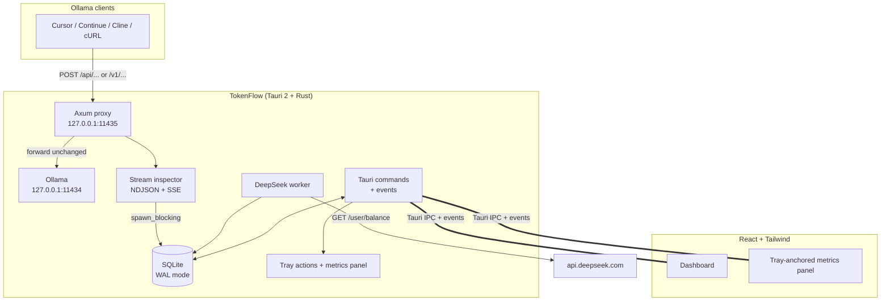

# Architecture

## Overview

TokenFlow is a local-first desktop analytics application that tracks usage of Ollama and DeepSeek large language model services. It runs a loopback Ollama proxy on `127.0.0.1:11435` that captures token counts from streamed responses, and a separate worker polls the DeepSeek balance API periodically. Usage history is stored in a local SQLite database, and DeepSeek API keys are managed via the OS credential store (Keychain on macOS/Windows, Secret Service on Linux). The application is built with Tauri 2, React, and TypeScript, providing a desktop tray and metrics panel for real-time monitoring.

## System context

TokenFlow operates entirely on the user's desktop with no cloud dependency for core functionality. The Ollama proxy runs on loopback only (`127.0.0.1:11435`), forwarding requests unchanged to the user's Ollama server on `127.0.0.1:11434`. DeepSeek balance polling targets `api.deepseek.com` over HTTPS. All data remains on the local machine; no usage data is transmitted to external services except the necessary API calls to Ollama and DeepSeek for real-time tracking.

A Mermaid diagram illustrates the system architecture:

## Components

- **Desktop shell**: Tauri 2 with two-action native tray menu on Windows/macOS, icon-only StatusNotifierItem on Linux, and two windows (`main` dashboard, `widget` panel).
- **Proxy**: Axum 0.7 running on loopback only, with hop-by-hop header filtering and a 64 MiB request body cap.
- **Stream parser**: Buffered NDJSON + SSE parser that handles input/output/cached token split, flushes complete lines only, and deduplicates by request ID.
- **Storage**: `rusqlite` (bundled SQLite) in WAL mode with embedded migrations, indexed queries, and deduplication via unique `request_id` index.
- **DeepSeek worker**: `reqwest` + rustls polling every 15 minutes by default, storing one row per currency with success and error timestamps.
- **Frontend**: React 18, TypeScript, Vite, Tailwind CSS, Framer Motion.
- **Events**: Tokio broadcast channel → Tauri events (`ollama-usage`, `deepseek-balance`, `proxy-status`).

## Request and data flow

### Ollama proxy path

Clients (`Cursor`, `Continue`, `Cline`, or `cURL`) send POST requests to TokenFlow's Axum proxy on `127.0.0.1:11435`. The proxy forwards requests unchanged to the user's Ollama server on `127.0.0.1:11434`. The stream inspector captures NDJSON and SSE data, buffers incomplete lines, and extracts `prompt_eval_count`, `prompt_eval_cached_count`, and `eval_count` from Ollama responses or `usage` fields from OpenAI-compatible responses. Complete lines are deduplicated by `request_id` and stored in SQLite.

### DeepSeek balance path

A background worker polls `api.deepseek.com` at configured intervals (default 15 minutes). One row per currency is stored in the `deepseek_sync` table with success and error timestamps. HTTPS is enforced unless the base URL is loopback. The last error is surfaced in Settings.

### UI and event path

Tauri commands and events synchronize data between the Rust backend and React frontend. The dashboard displays totals, today's streak, model breakdown, 365-day series, recent requests, balance, and proxy status. The tray-anchored metrics panel shows live input/output/cache numbers, a 14-day graph, DeepSeek balance breakdown, and Open/Take actions. Mock mode is available for `npm run dev` without Tauri.

## Storage model

TokenFlow uses a single shared SQLite connection in WAL mode behind a `Mutex`. Writes occur via `spawn_blocking` to avoid blocking the stream reactor. The connection has `busy_timeout` set, `synchronous = NORMAL`, and embedded migrations manage schema evolution. A unique index on `request_id` ensures deduplication via `INSERT OR IGNORE`. Local-day grouping uses `date(created_at, 'unixepoch', 'localtime')` with DST-safe boundaries. Cached-input token modeling tracks `prompt_eval_cached_count` and computes `uncached_input = prompt_eval_count - prompt_eval_cached_count`, with `cache_hit_rate = cached / total` clamped to prevent rates above 100%.

## Security and privacy model

- **Loopback-restricted CORS**: The proxy allows only missing `Origin` (native clients), `tauri://` origins, and loopback HTTP/HTTPS origins. This prevents drive-by browser access while not substituting for auth or shared-machine proxy tokens.
- **OS keychain with legacy migration**: API keys are stored via `keyring` 3 (macOS Keychain, Windows Credential Manager, Linux Secret Service). Environment variables take precedence and are never persisted. On startup, legacy plaintext SQLite rows are migrated to the keychain with read-back verification, then scrubbed with `secure_delete`, WAL checkpoint, and `VACUUM`. If the keychain is unavailable, the legacy key continues working with a Settings warning and retry action. Saving fails closed — no SQLite fallback is created.
- **No telemetry**: Usage data is not collected beyond what is necessary for local display.
- **Body cap**: Request bodies are capped at 64 MiB to prevent memory exhaustion.
- **Hop-by-hop header filtering**: Both request and response headers strip `Host`, `Content-Length`, `Accept-Encoding`, `Connection`, and other hop-by-hop headers. The response body is re-streamed without `Content-Length`.

## Design decisions

1. **Tauri owns the async runtime** — `src-tauri/src/main.rs` is a thin entry point. `run()` in `src-tauri/src/lib.rs` uses Tauri's builder, and background work is started with `tauri::async_runtime::spawn` / `tokio::task::spawn_blocking`. No outer `#[tokio::main]`.

2. **Buffered NDJSON and SSE parsing** — `StreamInspector` keeps a byte buffer, drains only complete lines, inspects `data:`-prefixed SSE lines and NDJSON, and flushes the tail when the upstream stream ends. Handles `usage.prompt_tokens` / `usage.completion_tokens` from OpenAI-compatible responses.

3. **Request-ID deduplication** — Every proxied request gets a unique `request_id`. SQLite has a unique index and uses `INSERT OR IGNORE`. The in-memory inspector records only once.

4. **Shared SQLite connection with WAL** — One `Db` behind a `Mutex`; WAL mode; `busy_timeout`; `synchronous = NORMAL`; `spawn_blocking` for writes; embedded migrations configured at startup.

5. **Hop-by-hop header filtering and body cap** — Strip hop-by-hop headers both directions; remove `Host`, `Content-Length`, `Accept-Encoding` from requests; remove `Content-Length` from responses (body re-streamed); re-stream response; 64 MiB request cap; structured 502 on upstream failure.

6. **Non-fatal proxy startup with live status** — Bind errors are captured in `ProxyStatus` and emitted as `proxy-status` event. Dashboard and sidebar surface the error; Settings screen remains usable.

7. **Loopback-restricted CORS** — Allow missing `Origin`, `tauri://`, and loopback HTTP/HTTPS origins only. Not a substitute for auth.

8. **Multi-currency DeepSeek polling and sync status** — One row per currency in `deepseek_sync`; success/error timestamps; last error in Settings; HTTPS required except loopback.

9. **OS keychain with legacy-key migration** — `keyring` 3: macOS Keychain, Windows Credential Manager, Linux Secret Service. Env var precedence; legacy SQLite migration with read-back verification; `secure_delete` + WAL checkpoint + `VACUUM`; fail closed; retry action in Settings.

10. **Explicit Tauri capabilities** — Minimal capability set: show, hide, close, focus, drag, always-on-top, positioning, monitor size, shell-open, core events. Tray built in Rust, so no tray permission exposed to webview.

11. **Platform-specific tray and widget lifecycle** — Windows/macOS native two-action menu (Show Widget, Quit). Linux `ksni` SNI with `Activate`, `SecondaryActivate`, DBusMenu. Double-click opens widget; single-click opens menu. Widget stores `(x, y)` activation hint and opens on the monitor owning the tray icon; does not use stale XWayland cursor position.

12. **Explicit restart semantics** — `SettingsView.restart_required` compares desired settings with running proxy; UI shows restart banner. Other preferences (always-on-top) apply immediately; poll interval picked up on next worker cycle.

13. **Typed dashboard contract and browser mock mode** — One typed dashboard command/DTO with totals, today, streak, model breakdown, 365-day series, recent requests, balance, proxy status. Deterministic mock for `npm run dev` without Tauri.

14. **Local-day timezone handling** — Store UTC epoch seconds; group with `date(created_at, 'unixepoch', 'localtime')`; local midnight boundaries; DST-safe streak calculation.

15. **Cached-input token modeling** — Migration `0002_cached_prompt_tokens.sql` adds `cached_prompt_tokens`. `uncached_input = prompt_eval_count - prompt_eval_cached_count`; `cache_hit_rate = cached / total`; clamp malformed data; surfaces in dashboard, tray, model rows, recent-request table.

## Technology stack

- **Framework**: Tauri 2, React 18, TypeScript, Vite, Tailwind CSS, Framer Motion
- **Backend**: Rust with `rusqlite` (bundled SQLite), `axum` (proxy), `reqwest` + `rustls` (DeepSeek worker), `keyring` 3 (OS credential store)
- **Stream parsing**: Custom buffered NDJSON + SSE parser in `proxy.rs`
- **Events**: Tokio broadcast channel → Tauri events
- **Icons**: Generated via `npm run icons` (`python3 scripts/generate_icons.py`)

## Repository map

The repository structure has been reorganized per the documentation standardization plan:

- `src/` — Frontend React components and pages
- `src-tauri/` — Rust backend, proxy, storage, Tauri configuration
- `docs/` — Documentation (being standardized per implementation plan)
- `flatpak/` — Flatpak build configuration and metadata
- `release/` — Released bundles and installers
- `scripts/` — Build and release helper scripts

Note: The `docs/` directory is being restructured per the documentation standardization plan. Content is being moved to new locations as defined in each phase.

## Known limitations and follow-ups

- Native Ollama responses report `prompt_eval_count`, `prompt_eval_cached_count`, `eval_count`; OpenAI-compatible responses only report `usage` when upstream includes a `usage` object.
- TokenFlow does not estimate tokens.
- Errored requests and interrupted streams are not counted.
- Duplicate suppression uses `request_id`.
- Deferred items: single-click GNOME tray activation, DeepSeek balance overlay, token estimation, proxy auth token, auto-updater/signing, retention/export, recorded-stream integration tests, cost estimation.
- Follow-ups: parser fixtures, cross-platform tray verification, keychain verification on macOS/Windows/GNOME/KDE, transparent-panel verification, export/backup path.

## Further reading

- [[CONTRIBUTING.md]] — Contribution guidelines
- [[RELEASING.md]] — Release process
- [[packaging/README.md]] — Packaging and distribution
- [[flatpak/README.md]] — Flatpak packaging
- [[BRANDING.md]] — Brand guidelines