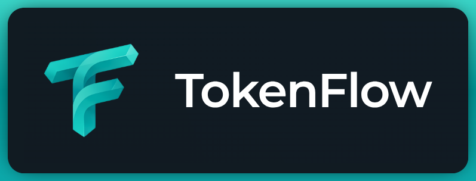

# TokenFlow

**LOCAL | SECURE | OPEN-SOURCE**

Local-first desktop analytics for Ollama and DeepSeek usage

[][website]

TokenFlow is a local-first desktop companion for Ollama and DeepSeek users. It runs a loopback proxy in front of Ollama, records the token counts reported by the stream, and polls the DeepSeek balance API.

## ✨ Features

📊 **Track Your Usage**
- Monitor token counts from Ollama conversations in real-time
- Watch input, output, and cached token breakdowns
- See your 30-day usage patterns at a glance
- Monthly calendar heat-map to track you usage for every month
- Click any day to drill into a 24-hour token chart, with All / Top 5 / per-model filters and a token-weighted cache rate
- Track Actual Input/Output tokens & Cache Hit Rate for your local models
- Delete or merge recorded model usage from the dashboard to keep experiments out of your metrics. This affects TokenFlow history only; it does not uninstall Ollama models.
- Your Deepseek account balance tracking
- Deepseek balance interactive trend chart (Day/Week/Month anchored to the selected day)

🔒 **Private & Local**
- Everything runs on your machine - no data leaves your desktop
- API keys stored securely in your OS keychain (Keychain/Credential Manager/Secret Service)
- Full offline functionality - works without internet connection (Deepseek balance tracking will need internet connection)

🖥️ **Native Desktop Experience**
- Tray-anchored metrics panel always at hand
- Dashboard with totals, today's streak, and model breakdown
- Cross-platform: Linux, Windows, and macOS support

## 📦 Install

- [GitHub Releases](https://github.com/siddheshgunjal/TokenFlow/releases/latest) for the latest binary

| Platform | Format | Architectures |
| --- | --- | --- |
| Linux | `.flatpak` | `x86_64`, `aarch64` |
| Linux | `.deb` | `x86_64`, `aarch64` |
| Linux | `.rpm` | `x86_64`, `aarch64` |
| Linux | AppImage | `x86_64`, `aarch64` |
| Windows | `.exe` | `x86_64`, `aarch64` |
| macOS | `.dmg` | `x86_64`, `aarch64` |

## 🚀 Getting Started

1. Ensure Ollama is running on `127.0.0.1:11434`
2. Launch TokenFlow and it will automatically proxy requests on `127.0.0.1:11435`
3. Point your Ollama clients at `http://127.0.0.1:11435` (native) or `/v1` (OpenAI-compatible)
4. Send completion requests - token counts appear in the dashboard after each stream

## ⚙️ How it works

- Proxy forwards unchanged requests to Ollama on `127.0.0.1:11435`
- Stream inspector records token counts from NDJSON/SSE response streams
- SQLite stores usage history in WAL mode with `spawn_blocking` writes
- React dashboard reads from shared SQLite via Tauri broadcast events (`ollama-usage`, `deepseek-balance`, `proxy-status`)
- DeepSeek balance fetched via `reqwest` + `rustls` on 15-minute polling cycle
- Records deduplicated by `request_id` via unique SQLite index using `INSERT OR IGNORE`
- See [ARCHITECTURE.md](ARCHITECTURE.md#how-it-works) for full details

## 🛡️ Privacy

- Loopback only — proxy listens on `127.0.0.1:11435` only; no network exposure or public accessibility
- No telemetry or usage data collected, stored, or transmitted beyond necessary API calls
- DeepSeek API key stored in OS credential store (Keychain on macOS, Windows Credential Manager, Linux Secret Service); environment variables take precedence and are never persisted to disk
- On startup, legacy plaintext SQLite key rows migrated to OS keychain with read-back verification, then scrubbed with `secure_delete`, WAL checkpoint, and `VACUUM`; if keychain unavailable, legacy key continues working with Settings warning and retry action
- Only outbound calls are DeepSeek balance requests to `api.deepseek.com` over HTTPS; no other external endpoints contacted

## 📚 Documentation

- [ARCHITECTURE.md](ARCHITECTURE.md) — full system design with all 15 design decisions
- [CONTRIBUTING.md](CONTRIBUTING.md) — contribution guidelines, development setup, coding standards, PR process
- [RELEASING.md](RELEASING.md) — release process, versioning, checklist, GitHub Actions workflow
- [packaging/README.md](packaging/README.md) — per-format build and install instructions
- [flatpak/README.md](flatpak/README.md) — Flatpak build, sandbox permissions, test matrix

## 🤝 Contributing

- Code follows existing Rust/TypeScript style; run `cargo fmt/clippy` and `npm run typecheck/build`
- New features and bug fixes welcome via pull requests; ensure test coverage and updated docs
- See CODE_OF_CONDUCT.md and SECURITY.md for expected behavior and security reporting
- Run `cargo test` and `npm test` locally; branch naming: feature/*, bugfix/*, docs/*

## 📄 License

GPL-3.0-only. See [LICENSE](LICENSE) for full text.

[website]: https://siddheshgunjal.github.io/
