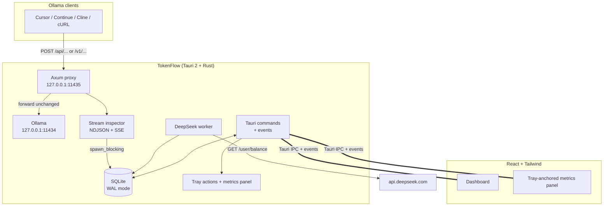

# TokenFlow

<!-- Brand mark -->


Local-first desktop analytics for **Ollama** and **DeepSeek** usage.

**LOCAL | SECURE | OPEN-SOURCE**

[[docs/branding.md]]

TokenFlow runs a loopback Ollama proxy on `127.0.0.1:11435`, forwards requests to
your existing Ollama server on `127.0.0.1:11434`, and records input, output, and
cached-input token counts from the response stream. A separate worker polls the
official DeepSeek balance API. Usage history is stored in a local SQLite
database and the DeepSeek key is kept in the OS credential store, all rendered
in a Tauri 2 desktop app with a live platform tray and a tray-anchored metrics
panel.

> Status: working scaffold. The Rust backend, proxy, storage, DeepSeek polling,
> tray, widget window, and dashboard UI are implemented. See
> [`docs/plan-review.md`](docs/plan-review.md) for intentional deviations from
> the original plan and deferred hardening work.

---

## Architecture



### Core pieces

| Layer | Implementation |
| --- | --- |
| Desktop shell | Tauri 2, two-action native tray menu on Windows/macOS, icon-only StatusNotifierItem on Linux, two windows (`main`, `widget` panel) |
| Proxy | Axum 0.7, loopback-only, hop-by-hop header filtering, 64 MiB body cap |
| Stream parsing | Buffered NDJSON + SSE parser for input/output/cached tokens, flushed on stream end, deduplicated by request ID |
| Storage | `rusqlite` (bundled SQLite), WAL mode, embedded migrations, indexed queries |
| DeepSeek | `reqwest` + rustls, poll every 15 minutes by default, one row per currency |
| Frontend | React 18, TypeScript, Vite, Tailwind CSS, Framer Motion |
| Events | Tokio broadcast channel → Tauri events (`ollama-usage`, `deepseek-balance`, `proxy-status`) |

---

## Prerequisites

- Rust **1.90+** with Cargo (current Tauri 2.12 dependency set)
- Node.js **20+** and npm **10+**
- Platform dependencies for Tauri 2

### Linux

Debian / Ubuntu:

```bash
sudo apt update
sudo apt install libwebkit2gtk-4.1-dev build-essential curl wget file \
  libxdo-dev libssl-dev librsvg2-dev libdbus-1-dev
```

Fedora:

```bash
sudo dnf install webkit2gtk4.1-devel openssl-devel dbus-devel curl wget file \
  libxdo-devel librsvg2-devel
sudo dnf group install "c-development"
```

Arch:

```bash
sudo pacman -S webkit2gtk-4.1 base-devel curl wget file openssl \
  librsvg
```

TokenFlow stores the DeepSeek API key in the OS keychain. On Linux this uses
Secret Service over D-Bus, so a provider such as `gnome-keyring`, KWallet with
Secret Service enabled, or KeePassXC must be installed and running. The app
fails closed with an actionable error if no provider is available. If the
build cannot find libdbus headers, install your distribution's
`libdbus-1-dev` (Debian/Ubuntu) or `dbus-devel` (Fedora) package.

### Windows

1. Install **Microsoft C++ Build Tools** with the “Desktop development with C++”
   workload.
2. Install the **Rust MSVC** toolchain (`rustup default stable-msvc`).
3. WebView2 is preinstalled on Windows 10/11; the installer bootstrapper is
   configured as a fallback.
4. Install Node.js 20+.

### macOS

```bash
xcode-select --install
```

Install Rust and Node.js, then continue. Minimum supported macOS version is
10.15 in `src-tauri/tauri.conf.json`.

---

## Install and run

```bash
npm install
npm run tauri dev
```

Build a production bundle for the current platform:

```bash
npm run version:sync
npm run tauri build
```

For release-shaped, normalized bundles use the platform scripts instead:

```bash
npm run bundle:linux:x64
npm run bundle:linux:arm64
npm run bundle:windows:x64
npm run bundle:windows:arm64
npm run bundle:macos:x64
npm run bundle:macos:arm64
npm run bundle:flatpak
```

The full distribution matrix, local prerequisites, Flatpak details, and install
notes are in [`docs/packaging.md`](docs/packaging.md). The GitHub release
workflow builds all supported assets on native runners.

> macOS builds are ad-hoc signed and not notarized, so Gatekeeper may require
> **Open Anyway** or clearing the quarantine attribute. Windows installers are
> unsigned, so SmartScreen may warn. See [`docs/packaging.md`](docs/packaging.md).

Useful scripts:

| Command | Purpose |
| --- | --- |
| `npm run dev` | Vite-only browser preview with deterministic mock data |
| `npm run typecheck` | TypeScript check |
| `npm run tauri dev` | Run the desktop app with hot reload |
| `npm run version:sync` | Propagate the root `VERSION` file to derived files |
| `npm run version:check` | Fail if any derived version is stale |
| `npm run bundle:linux:x64` | Build `.deb`, `.rpm`, and AppImage for x86_64 |
| `npm run bundle:linux:arm64` | Build `.deb`, `.rpm`, and AppImage for aarch64 |
| `npm run bundle:windows:x64` | Build the x86_64 NSIS `.exe` |
| `npm run bundle:windows:arm64` | Build the aarch64 NSIS `.exe` |
| `npm run bundle:macos:x64` | Build the x86_64 `.dmg` |
| `npm run bundle:macos:arm64` | Build the aarch64 `.dmg` |
| `npm run bundle:flatpak` | Build the host-architecture `.flatpak` |
| `npm run icons` | Regenerate `src-tauri/icons` from `scripts/generate_icons.py` |
| `cargo clippy --manifest-path src-tauri/Cargo.toml --all-targets -- -D warnings` | Rust lint |

Icons are already generated and committed. The icon script requires Python 3 and
Pillow; it is only a build-time asset tool.

---

## First run

1. Start Ollama normally (`ollama serve` or the desktop app). It should listen on
   `http://127.0.0.1:11434`.
2. Start TokenFlow. The proxy binds to `http://127.0.0.1:11435`.
3. In your IDE or client, set the Ollama base URL to the TokenFlow proxy:
   - **Continue:** `"apiBase": "http://127.0.0.1:11435"` with provider `ollama`
   - **Cursor / Cline / OpenAI-compatible:** base URL
     `http://127.0.0.1:11435/v1`, API key `ollama`
   - **cURL / other clients:** `http://127.0.0.1:11435/api/chat` or
     `http://127.0.0.1:11435/v1/chat/completions`
4. Send a request. Input and output counts appear after the final streaming
   chunk (or after a non-streaming response completes), together with cached
   input and cache hit rate when the upstream reports it.
5. For DeepSeek, add an API key in **Settings** (stored in the OS keychain) or
   set `DEEPSEEK_API_KEY` before launching.

Copyable client snippets are built into the Settings screen and use the currently
configured proxy port.

### Token metrics

TokenFlow separates additive **flow** metrics from per-request **gauge** metrics.

- **New input** is uncached input (`prompt_eval_count - prompt_eval_cached_count`)
  summed across requests. This is the primary input metric: tokens actually
  evaluated by the model.
- **Output** is generated tokens (`eval_count`), summed across requests.
- **Context** is the prompt size of one request (`prompt_eval_count`), including
  the cached prefix. It is a gauge, not a flow: chat clients resend the
  conversation on every turn, so summing it would count the same prefix
  repeatedly. Daily and per-model views show the peak context observed; the
  tray panel shows the most recent request's context.
- **Cached input** is `prompt_eval_cached_count` (or
  `usage.prompt_tokens_details.cached_tokens`) from the request that produced
  the displayed context.
- **Cache hit rate** is token-weighted: `sum(cached) / sum(context)` across the
  selected range or day.

For OpenAI-compatible responses, TokenFlow also reads
`usage.prompt_tokens_details.cached_tokens`. The same fields are shown in the
dashboard, recent-request table, and tray panel. The activity calendar can
switch between inference (new input + output), new input, output, and cache-rate
utilization views. Next to it, the DeepSeek card draws an area chart of the total
available balance with **Month**, **Week**, and **Day** ranges. **Week** is the
default and always shows the current Sunday–Saturday week. **Month** follows the
month selected in the activity calendar; **Day** always shows today.

### DeepSeek key precedence

1. `DEEPSEEK_API_KEY` environment variable
2. OS keychain: macOS Keychain, Windows Credential Manager, or Linux Secret Service
3. Legacy plaintext SQLite row, only until TokenFlow can migrate it

The environment variable wins and is never persisted. Keys saved through
Settings are written to the OS credential store; TokenFlow never returns the key
to the webview. On the first launch after an upgrade, an existing plaintext
SQLite key is moved to the keychain and scrubbed from the database with a WAL
checkpoint and `VACUUM`. If the keychain is unavailable, the legacy key keeps
working, Settings shows a warning, and a **Retry keychain** action re-attempts
the migration without restarting the app.

SQLite scrubbing only covers the live database and WAL. Historical backups,
filesystem snapshots, and SSD remanence are outside the app's control.

On macOS, unsigned development builds may prompt for Keychain access after a
rebuild because the Keychain ACL is tied to the code signature; a release build
signed with a stable identity avoids that prompt. In Flatpak, the manifest must
grant `--talk-name=org.freedesktop.secrets`; see
[`docs/flatpak.md`](docs/flatpak.md).

---

## Configuration

| Setting | Default | Notes |
| --- | --- | --- |
| Ollama upstream URL | `http://127.0.0.1:11434` | Must be `http://` or `https://` |
| Proxy port | `11435` | Loopback only, 1024–65535 |
| DeepSeek base URL | `https://api.deepseek.com` | HTTPS required except loopback |
| DeepSeek poll interval | `900` seconds | Clamped to 60–86400 |
| Start minimized | `false` | Launch into the tray, including at login |
| Launch at login | `false` | Starts at sign-in; login visibility follows Start minimized |
| Close to tray | `true` | Dashboard hides instead of exiting |
| Widget always on top | `true` | Applies immediately |
| Show widget on launch | `false` | Opens the panel; anchors near the tray when available, otherwise top-right |

First-launch defaults can be overridden with environment variables:

```bash
TOKENFLOW_UPSTREAM_URL=http://127.0.0.1:11434
TOKENFLOW_PROXY_PORT=11435
TOKENFLOW_DEEPSEEK_BASE_URL=https://api.deepseek.com
TOKENFLOW_DEEPSEEK_POLL_SECS=900
DEEPSEEK_API_KEY=sk-...
RUST_LOG=tokenflow=info,tower_http=warn
```

Saved settings take precedence over environment defaults after the first save
(except for the DeepSeek key). Proxy port and upstream URL changes require an app
restart; the Settings screen shows a banner when a restart is needed.

**Launch at login** writes a per-user login item: a LaunchAgent on macOS, an
`HKCU\...\Run` value on Windows, or an XDG autostart entry on Linux and
AppImage. The Flatpak build uses `org.freedesktop.portal.Background`, so it
needs no extra sandbox permission; the first toggle may show a desktop
permission prompt. Login launches follow **Start minimized**. A second launch
exits and focuses the running dashboard instead of starting a second proxy.

Inside a Flatpak, host environment variables are not inherited. Use
`flatpak run --env=DEEPSEEK_API_KEY=... io.github.siddheshgunjal.TokenFlow`. See
[`docs/flatpak.md`](docs/flatpak.md) for the required sandbox permissions and
the Flatpak test matrix.

---

## Data and privacy

- The proxy binds only to `127.0.0.1`; it is not exposed on the LAN.
- Telemetry never leaves the machine. The only outbound requests are DeepSeek
  balance calls to the configured DeepSeek origin.
- The database uses SQLite WAL mode and contains `ollama_logs` (including
  `cached_prompt_tokens`), `deepseek_balances`, `deepseek_sync`, and `settings`
  tables. The DeepSeek key is not stored there after migration.
- The DeepSeek API key is stored in the OS credential store (macOS Keychain,
  Windows Credential Manager, or Linux Secret Service) and is only loaded into
  process memory while TokenFlow is running.
- The database lives in Tauri’s app data directory for the identifier
  `io.github.siddheshgunjal.TokenFlow` (for example
  `~/.local/share/io.github.siddheshgunjal.TokenFlow/` on Linux,
  `~/Library/Application Support/io.github.siddheshgunjal.TokenFlow/` on macOS,
  and `%APPDATA%\io.github.siddheshgunjal.TokenFlow\` on Windows).
- `Settings → Danger zone` deletes usage and balance history while keeping
  settings and keys.
- CORS on the proxy is limited to loopback and Tauri origins. Native clients do
  not send an `Origin` header and are unaffected.

### Tray behavior

- **Windows and macOS** keep the native tray menu, reduced to two actions:
  **Show Widget** and **Quit TokenFlow**. Left-clicking the tray icon toggles the
  panel; right-click opens the menu. There are no metric rows or tray labels.
- **Linux (GNOME/AppIndicator)** uses a StatusNotifierItem with an embedded
  icon. There is no label next to the icon. **Double-click** the tray icon to
  open the widget; a single click opens a small menu with **Open TokenFlow**
  and **Quit TokenFlow**. Middle-click also opens the widget. Other SNI hosts
  may activate on a single click.
- The widget is anchored to the tray activation hint, so it opens on the
  monitor that owns the tray icon, directly below or above the panel.
- On Linux Wayland, TokenFlow automatically runs through XWayland when `DISPLAY`
  is available, because Wayland does not let a client position a regular
  toplevel window. This is what makes the widget appear under the tray icon
  instead of in the middle of the screen. Set `TOKENFLOW_NO_XWAYLAND=1` to opt
  out (the widget will then be placed by the compositor).
- The panel shows new (uncached) input and output for today, the latest
  request's context and cached prefix, token-weighted cache hit rate, DeepSeek
  total/granted/topped-up balance, and a 14-day new-input/output graph.
  **Open TokenFlow** and **Quit** are always available at the bottom.
- Opening the panel from the tray triggers an immediate data refresh, because
  hidden webviews throttle their timers. The header also has a manual refresh
  button that polls DeepSeek and reloads the local usage summary.
- The panel and dashboard update live from Tauri events.

### Measurement limitations

- Native Ollama `/api/generate` and `/api/chat` responses report
  `prompt_eval_count`, `prompt_eval_cached_count`, and `eval_count`; these are
  recorded. `prompt_eval_count` is the full prompt size, so uncached input is the
  difference between it and the cached count. Because chat clients resend the
  conversation on every turn, context and cached values are never summed across
  requests; TokenFlow reports peak context per day/model and the latest request
  in the tray.
- OpenAI-compatible requests only report usage when the upstream includes a
  `usage` object. TokenFlow records what Ollama/DeepSeek reports and does not
  estimate tokens.
- Requests that error upstream (HTTP 4xx/5xx) or streams interrupted before the
  final usage chunk are not counted.
- A duplicate-suppression index on `request_id` prevents double counting.

---

## Project layout

```text
TokenFlow/
├── src/                         # React frontend
│   ├── components/              # Activity calendar, cards, sidebar, icons
│   ├── lib/                     # Typed API bridge, formatting, browser mock
│   ├── pages/                   # Dashboard + Settings
│   ├── widget/                  # Tray-anchored metrics panel
│   ├── App.tsx
│   ├── main.tsx
│   └── widget.tsx
├── src-tauri/
│   ├── capabilities/default.json
│   ├── icons/                   # PNG / ICO / ICNS assets
│   ├── migrations/0001_init.sql
│   ├── migrations/0002_cached_prompt_tokens.sql
│   ├── src/
│   │   ├── autostart.rs         # Native login item + Flatpak background portal
│   │   ├── commands.rs          # Tauri IPC commands
│   │   ├── db.rs                # SQLite + queries + migrations
│   │   ├── deepseek.rs          # Balance poller
│   │   ├── error.rs
│   │   ├── lib.rs               # Tauri setup + window lifecycle
│   │   ├── main.rs
│   │   ├── models.rs            # IPC/event DTOs
│   │   ├── platform.rs          # Flatpak detection
│   │   ├── proxy.rs             # Axum proxy + stream inspector
│   │   ├── secrets.rs           # OS keychain + legacy-key migration
│   │   ├── settings.rs          # Validation + settings DTOs
│   │   ├── startup.rs           # --autostart launch detection
│   │   ├── state.rs             # Shared state + event bridge
│   │   └── tray.rs              # Platform tray, live metrics, window anchor
│   ├── Cargo.toml
│   └── tauri.conf.json
├── flatpak/                     # Flatpak manifests and metadata
├── packaging/                   # deb/rpm AppStream metadata
├── scripts/                     # Release, version, and Flatpak build helpers
├── docs/plan-review.md
├── docs/flatpak.md
├── docs/packaging.md
├── docs/flathub.md
├── VERSION                      # Single version source of truth
├── index.html
├── widget.html
├── package.json
└── tailwind.config.ts
```

---

## Vendor stack

| Crate / package | Role |
| --- | --- |
| `tauri` 2 | Desktop runtime, windows, tray, IPC |
| `tauri-plugin-single-instance` 2 | One running instance; a second launch focuses the dashboard |
| `tauri-plugin-autostart` 2 | macOS LaunchAgent, Windows Run value, or XDG autostart entry |
| `ashpd` 0.12 (Linux) | Flatpak Background portal for launch at login |
| `ksni` (Linux) | StatusNotifierItem with `Activate`, embedded icon, and a small menu |
| `axum` 0.7 | Ollama proxy server |
| `tower-http` 0.5 | Loopback-restricted CORS |
| `reqwest` 0.12 | Upstream proxy + DeepSeek HTTPS (rustls) |
| `rusqlite` 0.31 (`bundled`) | Embedded storage; no system SQLite dependency |
| `keyring` 3 | macOS Keychain, Windows Credential Manager, Linux Secret Service |
| `zeroize` 1 | Wipes secret key material from memory on drop |
| `tokio` 1 | Runtime, proxy listener, background workers |
| `chrono` | Local-day aggregation and streak calculation |
| React 18 + Vite 6 + TypeScript 5.6 | Dashboard and widget |
| Tailwind CSS 3.4 | Styling |
| Framer Motion 11 | Dashboard/page transitions |

---

## Roadmap / deferred hardening

- Code signing, macOS notarization, and auto-updater.
- Flathub submission when a Flathub account is available; the manifest and
  metadata are already prepared in [`docs/flathub.md`](docs/flathub.md).
- CSV/JSON export and configurable retention.
- A proxy auth token for shared machines (loopback alone is not an auth boundary).
- Integration tests that replay recorded NDJSON/SSE fixtures.
- Richer charts (per-model time series, cost estimation).

---

## License

GPL-3.0-only. See [LICENSE](LICENSE).
