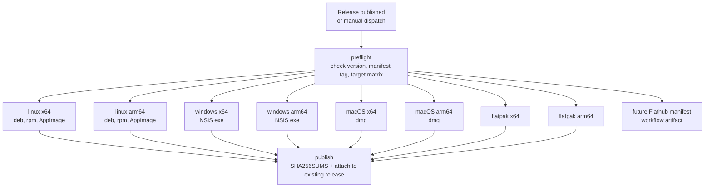

# Distribution and Release Plan

Status: **implemented** — packaging, local build scripts, and the release
workflow are in the tree. Local validation covers Fedora `.rpm` and `.flatpak`;
the remaining formats are built by CI and still need a smoke test on their
target platforms.
Date: 2026-11-03  
Scope: `.flatpak`, `.rpm`, `.deb`, `AppImage`, `.exe`, `.dmg` for 64-bit x86 and
64-bit ARM, built locally from source and published as GitHub Release assets.

Related: [`packaging.md`](packaging.md), [`flatpak.md`](flatpak.md),
[`flathub.md`](flathub.md), [`plan-review.md`](plan-review.md),
[`../README.md`](../README.md)

## Decisions incorporated (2026-11-03)

1. **Release trigger:** `release: published`; assets are built and attached
   after the release is published.
2. **macOS signing:** ship ad-hoc signed/unsigned builds with a documented
   Gatekeeper workaround. No Apple Developer ID for the first release.
3. **Windows signing:** unsigned `.exe` for now.
4. **Flathub:** no Flathub account today and no automated PR workflow. Keep the
   Flatpak manifest and metadata Flathub-ready for a future submission;
   screenshots are deferred until then. The generated future-submission
   manifest is attached as a workflow artifact on each release.
5. **Linux baseline:** Ubuntu 22.04 / Debian 12 / Fedora 38+ is acceptable.
6. **macOS architectures:** two per-architecture DMGs; no universal DMG.
7. **App identifier:** change from `io.tokenflow.desktop` to
   `io.github.siddheshgunjal.TokenFlow` everywhere. Existing pre-release app
   data and the saved DeepSeek key will be recreated; no migration is added.
8. **Asset names:** use the normalized names in section 4.
9. **Windows format:** NSIS `.exe` only; no MSI.
10. **Version source of truth:** a single root `VERSION` file containing plain
    semver (`0.1.0`). Derived files are synchronized from it; the release tag is
    `v$(cat VERSION)`.
11. **Flatpak distribution:** a single `.flatpak` asset; no `.flatpakref` or
    hosted OSTree repository.
12. **Release notes:** the workflow adds the "installers are building" sentence
    when it starts and removes it once all assets are uploaded.

## Implementation notes (2026-11-03)

The implemented tree differs from the original plan in these details:

- All local and CI build outputs land in the top-level `release/` directory.
  `dist/` is not used because `vite build` empties it during `tauri build`.
- The Linux tray uses `ksni`, a pure Rust StatusNotifierItem. The Flatpak
  manifest therefore contains only the TokenFlow module; no
  `shared-modules` tree or native indicator library is needed.
- The Flatpak uses `org.gnome.Platform//51` and installs the freedesktop SDK
  extensions at branch `26.08`, which is the extension point under that SDK.
- The `.deb`/`.rpm` AppStream file is a separate copy in `packaging/` with the
  Tauri-generated `TokenFlow.desktop` launchable. The Flatpak keeps its own
  metainfo under `flatpak/`.
- The `flathub-manifest` CI job renders the future submission manifest and
  uploads it as a workflow artifact. No workflow opens a Flathub PR.
- There is no automated grep guard for the old `io.tokenflow.desktop`
  identifier; the change was applied manually.

---

## 1. Scope and terminology

The requested architecture labels describe two architectures:

| User label | Equivalent label | Tauri target triple |
| --- | --- | --- |
| `x86_64` | `amd64` | `x86_64-unknown-linux-gnu`, `x86_64-pc-windows-msvc`, `x86_64-apple-darwin` |
| `aarch64` | `arm64` | `aarch64-unknown-linux-gnu`, `aarch64-pc-windows-msvc`, `aarch64-apple-darwin` |

No 32-bit, armv7, MSI, Snap, or AUR output is included in this plan.

| Format | Platform | How it is produced |
| --- | --- | --- |
| `.deb` | Linux (Debian/Ubuntu) | Tauri bundler |
| `.rpm` | Linux (Fedora/RHEL/openSUSE) | Tauri bundler |
| `AppImage` | Linux (portable) | Tauri bundler |
| `.flatpak` | Linux (sandboxed) | `flatpak-builder` + a Flatpak manifest, **not** a Tauri bundle target |
| `.exe` | Windows | Tauri NSIS installer |
| `.dmg` | macOS | Tauri bundler |

---

## 2. Current state

- Tauri `2.12.5`, `@tauri-apps/cli` `2.12.4`; React 18 + Vite 6 frontend.
- The Tauri identifier, keychain service, Flatpak ID, and Flatpak metadata now
  use `io.github.siddheshgunjal.TokenFlow`. The old `io.tokenflow.desktop`
  identifier was pre-release; there is no data migration.
- `src-tauri/tauri.conf.json` has `bundle.targets: "all"`. The repository also
  has six `bundle:*` scripts, `scripts/collect-bundles.sh`,
  `scripts/build-flatpak.sh`, and `.github/workflows/release.yml`.
- The Linux tray is implemented with `ksni` in Rust and the DeepSeek key uses
  Secret Service over D-Bus. The app needs no native AppIndicator runtime
  dependency; Flatpak only needs the Secret Service and
  `org.kde.StatusNotifierWatcher` D-Bus permissions.
- [`flatpak.md`](flatpak.md) already documents the intended Flatpak permissions
  and test matrix, but explicitly says the manifest is a separate workstream.
- The repository is public (`siddheshgunjal/TokenFlow`), so GitHub-hosted ARM64
  runners are available.

---

## 3. What Tauri already provides, and what it does not

Verified against the current Tauri v2 distribution docs:

| Requirement | Status |
| --- | --- |
| `.deb`, `.rpm`, `AppImage` | Native Tauri Linux bundle targets |
| `.exe` | Native Tauri NSIS target. MSI is separate and is not needed |
| `.dmg` | Native Tauri macOS target |
| `.flatpak` | **Not supported by the Tauri bundler.** A Flatpak manifest and `flatpak-builder` are required |
| Linux ARM64 AppImage | Supported, but `linuxdeploy` cannot cross-compile. It must be built on an ARM64 host/runner |
| Windows ARM64 `.exe` | Supported. The app binary is native ARM64; the NSIS installer stub itself runs as x86 under emulation |
| macOS Intel `.dmg` | Supported natively or by cross-compiling `x86_64-apple-darwin` on Apple Silicon |
| Source build | `npm run tauri build -- --target … --bundles …` already does a complete source build, including the Vite frontend |

The main non-Tauri work is therefore the Flatpak recipe and the CI release
pipeline.

---

## 4. Target artifact matrix

Final asset names are normalized so users do not have to know Tauri's internal
naming differences (`amd64` vs `x86_64`, `-setup`, etc.).

| # | Asset | Runner | Build target | Bundle command |
| --- | --- | --- | --- | --- |
| 1 | `TokenFlow-<version>-linux-x86_64.deb` | `ubuntu-22.04` | `x86_64-unknown-linux-gnu` | `--bundles deb` |
| 2 | `TokenFlow-<version>-linux-x86_64.rpm` | `ubuntu-22.04` | `x86_64-unknown-linux-gnu` | `--bundles rpm` |
| 3 | `TokenFlow-<version>-linux-x86_64.AppImage` | `ubuntu-22.04` | `x86_64-unknown-linux-gnu` | `--bundles appimage` |
| 4 | `TokenFlow-<version>-linux-x86_64.flatpak` | `ubuntu-24.04` | host `x86_64` | `flatpak-builder` + `flatpak build-bundle` |
| 5 | `TokenFlow-<version>-linux-aarch64.deb` | `ubuntu-22.04-arm` | `aarch64-unknown-linux-gnu` | `--bundles deb` |
| 6 | `TokenFlow-<version>-linux-aarch64.rpm` | `ubuntu-22.04-arm` | `aarch64-unknown-linux-gnu` | `--bundles rpm` |
| 7 | `TokenFlow-<version>-linux-aarch64.AppImage` | `ubuntu-22.04-arm` | `aarch64-unknown-linux-gnu` | `--bundles appimage` |
| 8 | `TokenFlow-<version>-linux-aarch64.flatpak` | `ubuntu-24.04-arm` | host `aarch64` | `flatpak-builder` + `flatpak build-bundle` |
| 9 | `TokenFlow-<version>-windows-x86_64-setup.exe` | `windows-2025` | `x86_64-pc-windows-msvc` | `--bundles nsis` |
| 10 | `TokenFlow-<version>-windows-aarch64-setup.exe` | `windows-11-arm` | `aarch64-pc-windows-msvc` | `--bundles nsis` |
| 11 | `TokenFlow-<version>-macos-x86_64.dmg` | `macos-15-intel` | `x86_64-apple-darwin` | `--bundles dmg` |
| 12 | `TokenFlow-<version>-macos-aarch64.dmg` | `macos-15` | `aarch64-apple-darwin` | `--bundles dmg` |
| 13 | `SHA256SUMS` | `ubuntu-24.04` | — | Generated after all builds |

Deb/rpm packages keep their native internal architecture metadata (`amd64` /
`arm64` in the `.deb` control file, `x86_64` / `aarch64` in the RPM header);
only the release asset filename is normalized. **Decision:** these normalized
names are the public release asset names; Tauri's native names are internal
build paths only. Every `<version>` placeholder is read from the root `VERSION`
file.

---

## 5. Building from source locally

### 5.1 Common prerequisites

- Rust 1.90+ with `cargo`
- Node.js 20+ and npm 10+ (Node 22 is what CI will use)
- The platform prerequisites already documented in the README

Additional Linux build packages:

```bash
# Debian / Ubuntu 22.04
sudo apt install build-essential curl wget file patchelf rpm \
  libwebkit2gtk-4.1-dev libgtk-3-dev librsvg2-dev libssl-dev \
  libxdo-dev libdbus-1-dev libfuse2

# Fedora
sudo dnf install webkit2gtk4.1-devel openssl-devel dbus-devel \
  libxdo-devel librsvg2-devel rpm-build
sudo dnf group install -y "c-development"
```

`rpm` is needed for the `.rpm` target even on Ubuntu. `libfuse2` is needed for
building/running AppImages on Ubuntu 22.04. Flatpak additionally needs
`flatpak` and `flatpak-builder`.

The supported Linux floor for the released packages is **Ubuntu 22.04, Debian
12, and Fedora 38+**. Build `.deb`/`.rpm`/AppImage on Ubuntu 22.04 so the
glibc requirement stays at 2.35. Older distributions are out of scope for this
release.

The local development machine is Fedora, so only `.rpm` and `.flatpak` have
been exercised locally. `.deb`, AppImage, Windows, and macOS artifacts are built
by CI and need a smoke test on their target platforms.

### 5.2 npm scripts

```json
{
  "bundle:linux:x64": "npm run version:sync && tauri build --target x86_64-unknown-linux-gnu --bundles deb,rpm,appimage",
  "bundle:linux:arm64": "npm run version:sync && tauri build --target aarch64-unknown-linux-gnu --bundles deb,rpm,appimage",
  "bundle:windows:x64": "npm run version:sync && tauri build --target x86_64-pc-windows-msvc --bundles nsis",
  "bundle:windows:arm64": "npm run version:sync && tauri build --target aarch64-pc-windows-msvc --bundles nsis",
  "bundle:macos:x64": "npm run version:sync && tauri build --target x86_64-apple-darwin --bundles dmg",
  "bundle:macos:arm64": "npm run version:sync && tauri build --target aarch64-apple-darwin --bundles dmg",
  "bundle:flatpak": "bash scripts/build-flatpak.sh",
  "version:sync": "node scripts/sync-version.mjs",
  "version:check": "node scripts/check-release-version.mjs",
  "prebuild": "npm run version:sync"
}
```

Each `tauri build` invocation runs the `beforeBuildCommand` (`npm run build`),
so the frontend never has to be built separately.

### 5.3 Architecture constraints

| Host | Can build | Notes |
| --- | --- | --- |
| Linux x86_64 | Linux x86_64 `.deb`/`.rpm`/AppImage | Normal path |
| Linux aarch64 | Linux aarch64 `.deb`/`.rpm`/AppImage | AppImage cannot be cross-built; use an ARM64 machine |
| Linux x86_64 | Linux aarch64 `.deb`/`.rpm` only | Possible with a cross toolchain and `PKG_CONFIG_SYSROOT_DIR`; not recommended for AppImage |
| Windows x86_64 | Windows x86_64 `.exe` | Normal path |
| Windows x86_64 | Windows aarch64 `.exe` | Requires the MSVC ARM64 build tools and `aarch64-pc-windows-msvc`; native ARM runner is preferred |
| macOS Apple Silicon | macOS aarch64 `.dmg` | Normal path |
| macOS Apple Silicon | macOS x86_64 `.dmg` | `rustup target add x86_64-apple-darwin`; cross-build is supported |
| Any Linux | Flatpak | Only for the host architecture. `flatpak-builder` only supports host-compatible architectures |

### 5.4 Bundle collection

Add `scripts/collect-bundles.sh` so local builds and CI produce the same names:

```bash
bash scripts/collect-bundles.sh --platform linux --arch x86_64 \
  --target x86_64-unknown-linux-gnu
```

The script reads `VERSION` and copies the expected files from
`src-tauri/target/<target>/release/bundle/{deb,rpm,appimage,nsis,dmg}` into
`release/` with the normalized names above. It fails if an expected file is
missing. `release/` is gitignored.

---

## 6. Flatpak design

### 6.1 Why a manifest is required

The Tauri bundler has no Flatpak target. The supported approach is a
`flatpak-builder` manifest that builds the app from source inside the
`org.gnome.Platform` SDK, then `flatpak build-bundle` to produce a single-file
`.flatpak`.

### 6.2 Manifest outline

The release manifest is `flatpak/io.github.siddheshgunjal.TokenFlow.yml`. It uses a
`type: git` source at the release tag. It intentionally does **not** embed a
commit hash: a file inside the repository cannot pin the commit that contains
it. The Flathub submission manifest is rendered after the tag exists and adds
both the tag and the commit. A local worktree variant,
`flatpak/io.github.siddheshgunjal.TokenFlow.dev.yml`, replaces the source block with
`type: dir` for fast iteration.

```yaml
id: io.github.siddheshgunjal.TokenFlow
runtime: org.gnome.Platform
runtime-version: '51'
sdk: org.gnome.Sdk
command: tokenflow

finish-args:
  - --share=ipc
  - --share=network
  - --socket=wayland
  - --socket=x11
  - --device=dri
  - --talk-name=org.freedesktop.secrets
  - --talk-name=org.kde.StatusNotifierWatcher

sdk-extensions:
  - org.freedesktop.Sdk.Extension.node22
  - org.freedesktop.Sdk.Extension.rust-stable

build-options:
  append-path: /usr/lib/sdk/node22/bin:/usr/lib/sdk/rust-stable/bin

modules:
  - name: tokenflow
    buildsystem: simple
    build-options:
      env:
        HOME: /run/build/tokenflow
        CARGO_HOME: /run/build/tokenflow/cargo-home
        CARGO_NET_OFFLINE: 'true'
        npm_config_cache: /run/build/tokenflow/flatpak-node/npm-cache
        npm_config_offline: 'true'
        npm_config_audit: 'false'
        npm_config_fund: 'false'
    sources:
      # Release manifest: tag-pinned. The Flathub submission manifest adds the
      # commit hash after the tag exists.
      - type: git
        url: https://github.com/siddheshgunjal/TokenFlow.git
        tag: v0.1.0
      - flatpak-cargo-sources.json
      - node-sources.json
    build-commands:
      - mkdir -p "$CARGO_HOME"
      - printf '[source.crates-io]\nreplace-with = "vendored-sources"\n[source.vendored-sources]\ndirectory = "/run/build/tokenflow/cargo/vendor"\n' > "$CARGO_HOME/config.toml"
      - npm ci --offline
      - npm run tauri build -- --no-bundle
      - install -Dm755 src-tauri/target/release/tokenflow /app/bin/tokenflow
      - install -Dm644 flatpak/io.github.siddheshgunjal.TokenFlow.desktop /app/share/applications/io.github.siddheshgunjal.TokenFlow.desktop
      - install -Dm644 flatpak/io.github.siddheshgunjal.TokenFlow.metainfo.xml /app/share/metainfo/io.github.siddheshgunjal.TokenFlow.metainfo.xml
      - install -Dm644 src-tauri/icons/32x32.png /app/share/icons/hicolor/32x32/apps/io.github.siddheshgunjal.TokenFlow.png
      - install -Dm644 src-tauri/icons/128x128.png /app/share/icons/hicolor/128x128/apps/io.github.siddheshgunjal.TokenFlow.png
      - install -Dm644 src-tauri/icons/256x256.png /app/share/icons/hicolor/256x256/apps/io.github.siddheshgunjal.TokenFlow.png
      - install -Dm644 src-tauri/icons/512x512.png /app/share/icons/hicolor/512x512/apps/io.github.siddheshgunjal.TokenFlow.png
```

The dev variant changes only the source block:

```yaml
    sources:
      - type: dir
        path: ..
        skip: [.git, node_modules, src-tauri/target, dist, agent_runs]
      - flatpak-cargo-sources.json
      - node-sources.json
```

Key points:

- `runtime-version: '51'` is the current GNOME runtime at the time of planning.
  It provides WebKitGTK 4.1 (verified locally in the runtime).
- The Linux tray is implemented with `ksni`, so the manifest has no
  `shared-modules` stack and no native AppIndicator library. The icon is an
  embedded ARGB pixmap.
- Generated `flatpak-cargo-sources.json` and `node-sources.json` make the build
  offline: `flatpak-cargo-generator.py` for `src-tauri/Cargo.lock`, and
  `flatpak-node-generator npm` for `package-lock.json`. They are committed and
  regenerated whenever the lockfiles change.
- Pin the generator commit (or vendor the generator) and expose the commands
  through `scripts/update-flatpak-sources.sh`. Optionally add a CI check that
  regenerating them produces no diff, so stale sources cannot silently break an
  offline build.
- `org.freedesktop.Sdk.Extension.node22` and
  `org.freedesktop.Sdk.Extension.rust-stable` resolve through the freedesktop
  SDK under GNOME 51, whose extension branch is **26.08**. The workflow installs
  `node22//26.08` and `rust-stable//26.08` explicitly; the manifest keeps bare
  extension names so `flatpak-builder` resolves them against the SDK extension
  point. `node22` is used because the project only requires Node 20+.
- `tauri build --no-bundle` avoids building a `.deb` inside the sandbox; the
  binary and desktop metadata are installed directly into `/app`.
- The release manifest is pinned to the release tag. The preflight job verifies
  that the tag matches the release tag. Because a commit cannot embed its own
  hash, `prepare-flatpak-release.mjs` renders the Flathub submission manifest
  with the released tag and commit after the tag exists.
- `flatpak/io.github.siddheshgunjal.TokenFlow.dev.yml` is the worktree manifest.
  CI builds the `.flatpak` release asset with `scripts/build-flatpak.sh`; when a
  release tag is supplied the script uses the tag-pinned release manifest, and
  on a tagless dry run it uses the worktree manifest. Flathub builds the
  rendered submission manifest. Manifest drift is checked by review, not CI.

Regenerate the vendored sources with:

```bash
bash scripts/update-flatpak-sources.sh
```

The script downloads the pinned `flatpak-builder-tools` commit through `uv`
and writes both generated files from the lockfiles.

### 6.3 Flatpak-specific code changes

The Linux tray is implemented with `ksni`, a pure Rust StatusNotifierItem.
It exports the full SNI interface, including `Activate`, `SecondaryActivate`, a
DBusMenu, and an embedded ARGB `IconPixmap`. The icon never depends on a host
path or icon theme, which removes the sandbox path problem entirely.

Inside Flatpak the service calls `disable_dbus_name(true)`. A sandbox cannot
own the process-derived `org.kde.StatusNotifierItem-<pid>-<id>` name, so the
service registers with the watcher under its unique connection name. That is
the supported sandbox pattern and still lets the host call `Activate` and read
properties. `assume_sni_available(true)` keeps the service alive when the host
extension is not running yet and lets it reconnect when the watcher appears.

On activation, the app stores the `(x, y)` hint supplied by the host as a
physical anchor. Do not read `cursor_position()` for this: when the pointer is
over a Wayland panel, XWayland can return a stale position from the last X11
window, and repeated opens then drift toward the old widget location. The hint
is identity on scale-1 layouts; mixed-scale layouts can be refined separately
without regressing the common case.

### 6.4 Flatpak metadata

Add:

- `flatpak/io.github.siddheshgunjal.TokenFlow.desktop` — `Exec=tokenflow`,
  `Icon=io.github.siddheshgunjal.TokenFlow`, `Categories=Development;Utility;`, and a
  `StartupWMClass` verified against the running app.
- `flatpak/io.github.siddheshgunjal.TokenFlow.metainfo.xml` — AppStream ID, name, summary,
  description, `project_license` = `GPL-3.0-only`, launchable desktop ID,
  homepage, releases, OARS content rating. Screenshots are deferred; add them
  before the future Flathub submission.
- `src-tauri/icons/256x256.png` and `512x512.png`. The source `icon.png` is
  1024×1024; extend `scripts/generate_icons.py` to emit the two missing sizes.

The same metainfo content is copied into the `.deb` and `.rpm` through
`bundle.linux.deb.files` / `bundle.linux.rpm.files`, but from
`packaging/io.github.siddheshgunjal.TokenFlow.metainfo.xml`. Tauri names the
installed desktop entry `TokenFlow.desktop`, so the deb/rpm copy uses that
launchable ID while the Flatpak copy keeps the application ID.

### 6.5 Producing the asset

```bash
# Local build from the working tree (the dev manifest uses a dir source).
flatpak-builder --force-clean --disable-rofiles-fuse \
  --default-branch=stable \
  --repo=flatpak/repo --state-dir=flatpak/.state \
  flatpak/build flatpak/io.github.siddheshgunjal.TokenFlow.dev.yml

flatpak build-bundle \
  --arch="$FLATPAK_ARCH" \
  --runtime-repo=https://flathub.org/repo/flathub.flatpakrepo \
  flatpak/repo \
  release/TokenFlow-<version>-linux-<arch>.flatpak \
  io.github.siddheshgunjal.TokenFlow stable
```

The release workflow passes `--release` to `scripts/build-flatpak.sh`, which
uses the tag-pinned `io.github.siddheshgunjal.TokenFlow.yml` and the generated
offline sources instead of the worktree manifest. The tag-pinned manifest is
also the Flathub parity check: building it proves the remote tag source works.
The generated Flathub submission manifest is what would go into the external
Flathub repository when a future submission is made.

The `.flatpak` references `org.gnome.Platform//51`; users install that runtime
from Flathub. Document this in the install instructions:

```bash
flatpak install flathub org.gnome.Platform//51
flatpak install --user ./TokenFlow-<version>-linux-<arch>.flatpak
```

### 6.6 Flathub readiness (future submission)

There is no Flathub account today, and no workflow will create or update a PR in
the Flathub repository. The goal is to keep the manifest, metadata, and build
process ready so a future submission is a packaging step rather than a rewrite.
Flathub's review requirements:

- **Pinned upstream source.** The future Flathub submission manifest is
  rendered after the tag exists and pins both the release tag and the commit.
  No `type: dir` source is submitted to Flathub.
- **AppStream metadata.** `io.github.siddheshgunjal.TokenFlow.metainfo.xml` must pass
  `appstreamcli validate --no-net` and include a developer name and ID,
  homepage, `metadata_license` (for example `CC0-1.0`), `project_license`
  (`GPL-3.0-only`), and OARS content rating. Screenshots are deferred for now;
  they are a blocker for the eventual Flathub submission and must be added
  before submitting. When added, prefer stable URLs (for example the GitHub raw
  URL at the release tag) so Flathub can mirror them. Update the `<releases>`
  entry for every release.
- **Desktop integration.** The installed `.desktop` file, icon names, and
  `StartupWMClass` must be consistent. Install 128×128, 256×256, and 512×512
  icons under the `io.github.siddheshgunjal.TokenFlow` icon name.
- **Reproducible offline build.** `flatpak-cargo-sources.json` and
  `node-sources.json` are committed, and the app module uses
  `CARGO_NET_OFFLINE`, `npm --offline`, and the vendored cargo directory. The
  only network access during a Flathub build is flatpak-builder fetching the
  declared source archives, as required. For a future submission, copy the two
  generated source files and the rendered submission manifest into the external
  Flathub repository; the desktop file, metainfo, and icons come from the
  upstream git source.
- **No shared modules.** The tray is pure Rust (`ksni`), so there is no
  `shared-modules` or native indicator source in the manifest. The icon is an
  embedded pixmap.
- **Architecture coverage.** Do not add `only-arches` to the app module; Flathub
  builds both x86_64 and aarch64 from the same manifest.
- **Permissions review.** The `finish-args` in section 6.2 are justified by
  [`flatpak.md`](flatpak.md): network for the loopback proxy and DeepSeek, X11
  for tray-anchored widget placement, Secret Service for the API key, and the
  StatusNotifier watcher for the tray. Include that rationale in the Flathub
  submission notes.
- **Linting.** Run `flatpak-builder-lint manifest` and
  `flatpak-builder-lint builddir` in CI and locally before submission.
- **No build-time secrets.** Flathub builds cannot access repository secrets;
  the app must build without them. All signing/credential material remains a
  runtime user concern.

No Flathub PR is created today. The release workflow renders the future
submission manifest and attaches it as a GitHub Actions workflow artifact on
each release (for example `flathub-manifest-v0.1.0`). The generated sources
remain in the repository, and `docs/flathub.md` records the checklist. Nothing
is uploaded to the GitHub release as a Flathub asset, and submission becomes
possible when a Flathub account is available. When that happens, the maintainer forks
`flathub/flathub`, creates a `new-pr` branch, adds the
`io.github.siddheshgunjal.TokenFlow` manifest and metadata, and opens the PR.
The app ID must remain `io.github.siddheshgunjal.TokenFlow`, matching the
keychain service and desktop identifiers.

---

## 7. Packaging configuration changes

### 7.1 `src-tauri/tauri.conf.json`

Add explicit Debian runtime dependencies and install the shared metainfo:

```json
"bundle": {
  "licenseFile": "../LICENSE",
  "linux": {
    "deb": {
      "depends": [
        "libwebkit2gtk-4.1-0",
        "libgtk-3-0",
        "libxdo3",
        "libdbus-1-3"
      ],
      "files": {
        "/usr/share/metainfo/io.github.siddheshgunjal.TokenFlow.metainfo.xml": "../packaging/io.github.siddheshgunjal.TokenFlow.metainfo.xml"
      }
    },
    "rpm": {
      "depends": ["libdbus-1.so.3()(64bit)"],
      "files": {
        "/usr/share/metainfo/io.github.siddheshgunjal.TokenFlow.metainfo.xml": "../packaging/io.github.siddheshgunjal.TokenFlow.metainfo.xml"
      }
    }
  }
}
```

- For RPM, rpmbuild adds the native `NEEDED` sonames automatically. The tray
  is pure Rust, so there is no indicator library to declare explicitly.
  Package names differ between Fedora, RHEL, and openSUSE; verify with
  `rpm -qpR` after building.
- Keep `bundle.targets: "all"` in the config. CI passes `--bundles` explicitly
  so no platform attempts to build a bundle it cannot produce.
- Keep `webviewInstallMode: downloadBootstrapper`. Verify on Windows 11 ARM64
  that it downloads the correct WebView2 runtime; switch to `embedBootstrapper`
  only if the ARM64 test fails.

### 7.2 Version source of truth

Add a root `VERSION` file containing a plain semantic version, for example
`0.1.0`. This is the only file a maintainer edits for a release.

Tauri only accepts a semver string or a path to a `package.json`, and Cargo
cannot read an external version file, so a single synchronizer script is needed.
Add `scripts/sync-version.mjs` to propagate `VERSION` to:

- `package.json` → `version`
- `package-lock.json` → root package version metadata (refresh with
  `npm install --package-lock-only --ignore-scripts`)
- `src-tauri/Cargo.toml` → `[package].version`
- `src-tauri/Cargo.lock` → the local `tokenflow` package entry
- `src-tauri/tauri.conf.json` → `version`
- `flatpak/io.github.siddheshgunjal.TokenFlow.yml` → `tag: v<version>`
- `flatpak/io.github.siddheshgunjal.TokenFlow.metainfo.xml` → the current
  `<releases>` entry (via `prepare-flatpak-release.mjs`)

Add these npm scripts:

```json
"version:sync": "node scripts/sync-version.mjs",
"version:check": "node scripts/check-release-version.mjs",
"prebuild": "npm run version:sync"
```

`prebuild` hook ensures frontend-only `npm run build` invocations use the
`VERSION` value. It is **not sufficient by itself** for Tauri builds: the Tauri
CLI reads `tauri.conf.json` before it runs `beforeBuildCommand`, so every
`bundle:*` script explicitly runs `npm run version:sync` before `tauri build`.
`scripts/build-flatpak.sh` runs `version:sync` before `flatpak-builder` reads the
manifest. Direct `tauri build` invocations are only supported after
`npm run version:sync`; documentation should direct users to the bundle scripts.
`version:sync` also refreshes the local `tokenflow` entry in
`src-tauri/Cargo.lock` (and `package-lock.json` metadata) so a `--locked` build
is not stale.

`scripts/check-release-version.mjs` reads `VERSION` and fails if any derived
file disagrees. The release tag must be `v$(cat VERSION)`; the preflight job
compares the release tag, `VERSION`, and all derived values. `prepare-flatpak-release.mjs`
and `collect-bundles.sh` read `VERSION` directly, and all artifact names use it.

### 7.3 Repository additions

```text
VERSION                               # single source of truth for the version
.github/workflows/release.yml
flatpak/
├── io.github.siddheshgunjal.TokenFlow.yml          # release manifest (git tag)
├── io.github.siddheshgunjal.TokenFlow.dev.yml      # worktree/CI manifest (dir source)
├── io.github.siddheshgunjal.TokenFlow.desktop
├── io.github.siddheshgunjal.TokenFlow.metainfo.xml
├── flatpak-cargo-sources.json
├── node-sources.json
packaging/
└── io.github.siddheshgunjal.TokenFlow.metainfo.xml # deb/rpm launchable ID
scripts/
├── build-flatpak.sh
├── check-release-version.mjs
├── collect-bundles.sh
├── release-notes.mjs                 # add/remove the building sentence
├── update-flatpak-sources.sh
└── prepare-flatpak-release.mjs       # VERSION → manifest tag + release entry
src-tauri/icons/256x256.png
src-tauri/icons/512x512.png
docs/packaging.md                     # user-facing build/install docs
docs/flatpak.md                       # Flatpak build, sandbox, and test matrix
docs/flathub.md                       # future submission checklist
```

Also update `.gitignore` for `release/`, `release/.tmp/`, `flatpak/build/`,
`flatpak/repo/`, `flatpak/.state/`, and `.tools/`.

The release and worktree manifests must not drift; this is currently checked by
review rather than a CI job. `version:sync` keeps the release manifest tag
aligned with `VERSION`.
`prepare-flatpak-release.mjs` adds the current release to the metainfo
`<releases>` entry during the version-bump commit. After the tag exists, a
second invocation (or the release workflow) renders the Flathub submission
manifest with the released tag and commit. The generated submission manifest is
not a committed file; the release workflow uploads it as a GitHub Actions
workflow artifact for a future Flathub submission. No workflow opens a PR
against Flathub.

### 7.4 App identifier change

Decision: change the identifier from `io.tokenflow.desktop` to
`io.github.siddheshgunjal.TokenFlow` everywhere. This is a breaking change, even
though there is no public release yet.

| Location | Change |
| --- | --- |
| `src-tauri/tauri.conf.json` | `identifier` → `io.github.siddheshgunjal.TokenFlow` |
| `src-tauri/src/secrets.rs` | keychain `SERVICE` → `io.github.siddheshgunjal.TokenFlow` |
| Flatpak manifest | `id`, desktop file, metainfo, icon, and `flatpak run` IDs |
| `README.md` | app-data paths, `flatpak run`, and keychain notes |
| `docs/flatpak.md` | ID, `~/.var/app/...`, `secret-tool`, and Flatpak override examples |
| Tests / scripts | remove any hardcoded old identifier (done manually; no automated grep guard yet) |

Consequences:

- Tauri's app-data directory changes on Linux, macOS, and Windows. An existing
  development database under the old identifier will not be discovered
  automatically.
- The OS keychain service name changes. Existing development keys are
  re-entered; no migration is implemented.
- macOS bundle identity and keychain ACLs, and Windows app-data/uninstall keys,
  change with the identifier.
- There is no released user base yet, and the decision is to accept the clean
  break. Recreate the local development database and re-enter the DeepSeek key;
  no data or keychain migration is planned. Document this in `README.md` and
  `docs/flatpak.md` when the identifier changes.

`README.md`, `docs/flatpak.md`, and `docs/packaging.md` were updated with the
config and keychain constant. No automated grep guard is in place; a manual
sweep confirmed the old identifier appears only in the decision log and this
section.

---

## 8. GitHub Actions release workflow

### 8.1 Trigger

**Decision:** `on: release: types: [published]`, plus `workflow_dispatch`.

1. Maintainer updates `VERSION`, commits, and publishes a GitHub Release for
   tag `v$(cat VERSION)` (for example `v0.1.0`).
2. The workflow starts from the release tag and runs the full matrix. Preflight
   fails unless the tag matches `VERSION` exactly.
3. The publish job attaches all 12 normalized artifacts plus `SHA256SUMS` to the
   already-published release.
4. Users can see the release immediately; installers appear when CI finishes.

Because assets are attached after publication, the workflow adds this sentence
to the release body when it starts:

> Installers are built automatically by GitHub Actions and will appear below
> shortly.

The publish job removes the sentence after all assets are uploaded.
`scripts/release-notes.mjs` wraps it in HTML comment sentinels, removes any
existing copy before adding it, and edits only the marked block, so re-runs are
idempotent and the rest of the release notes are preserved.

The separate future-Flathub submission manifest is uploaded as a GitHub Actions
workflow artifact (`flathub-manifest-v<version>`), not as a release asset.

Both stable and pre-release publications trigger the workflow, so a
`v0.1.0-rc.1` pre-release is the supported dry-run path. For the first stable
release, publishing as a pre-release first and promoting it after the assets
attach keeps the no-assets window out of the stable channel. The workflow file
must exist on the default branch for the release trigger to fire.

`workflow_dispatch` supports two modes: with a `tag` input, rebuild and
re-upload assets for an existing published release; without a tag, build the
matrix and upload workflow artifacts only. Re-runs use
`gh release upload --clobber`, so a partial or failed upload can be repaired
without deleting the release.

### 8.2 Job graph



All build jobs run in parallel (`fail-fast: false`). The publish job runs only
if every build job succeeds.

### 8.3 Job details

| Job | Runner | Key steps |
| --- | --- | --- |
| `preflight` | `ubuntu-24.04` | Checkout `github.event.release.tag_name` (or manual `tag` input); run `version:check` against the tag; verify the release Flatpak manifest tag; add the release-body building note when a release tag is supplied; expose `version` output |
| `linux` matrix | `ubuntu-22.04`, `ubuntu-22.04-arm` | Install WebKitGTK/GTK/rpm/fuse deps; Node 22; Rust target; `npm ci`; `npm run bundle:linux:*`; `collect-bundles.sh`; upload artifact |
| `windows` matrix | `windows-2025`, `windows-11-arm` | Node 22; Rust MSVC target; `npm ci`; `npm run bundle:windows:*`; collect; upload |
| `macos` matrix | `macos-15-intel`, `macos-15` | Node 22; Rust target; `npm ci`; ad-hoc signing (`APPLE_SIGNING_IDENTITY=-`); `npm run bundle:macos:*`; collect; upload |
| `flatpak` matrix | `ubuntu-24.04`, `ubuntu-24.04-arm` | Install `flatpak`/`flatpak-builder` and appstream tools; add Flathub; install runtime/SDK/extensions; validate metadata; build with `scripts/build-flatpak.sh` (release manifest when a tag is supplied); upload the `.flatpak` |
| `flathub-manifest` | `ubuntu-24.04` | Checkout the release tag (skip on a tagless dry run); run `prepare-flatpak-release.mjs --render-flathub`; upload `io.github.siddheshgunjal.TokenFlow.flathub.yml` as workflow artifact `flathub-manifest-v<version>` (not a release asset) |
| `publish` | `ubuntu-24.04` | Download artifacts by `*-x86_64` and `*-aarch64` patterns; generate `SHA256SUMS`; verify the published release exists; `gh release upload --clobber`; remove the release-body building note |

No job creates, edits, or publishes the GitHub Release. The release is created
and published by the maintainer; the workflow only attaches assets.

Why `ubuntu-22.04` for the Tauri Linux jobs: it sets the lowest practical glibc
baseline for this Tauri version (glibc 2.35), as recommended by Tauri. Flatpak
jobs can use `ubuntu-24.04` because the app is built against the runtime's glibc
inside the Flatpak sandbox, not the host's.

### 8.4 Publish job behavior

```bash
gh release view "$TAG" >/dev/null   # fail if the published release is missing

rm -f release/SHA256SUMS
(cd release && sha256sum * > SHA256SUMS)
gh release upload "$TAG" release/* --clobber
node scripts/release-notes.mjs remove --tag "$TAG"
```

Artifacts are downloaded in two passes, `*-x86_64` and `*-aarch64`, each with
`merge-multiple: true`. A single download of `*` would collide because every
artifact contains a same-named file set.

The release must already exist and be published. A re-run replaces assets
because of `--clobber`, and the workflow uses a `concurrency` group keyed by tag
so a re-run cannot race itself. The `preflight` job and the `publish` job need
`contents: write` for the release-body edit; the build jobs use
`contents: read`. The building sentence is removed only after the upload
succeeds. If the body edit fails, leave the sentence in place and record a
warning rather than failing the builds; it is cosmetic and can be cleaned up
manually. For a dry run without a tag, the publish job is skipped and only
workflow artifacts are produced.

### 8.5 Signing and platform warnings

**Decision for the first release: no code-signing certificates.** The workflow
will be structured so signing can be added later without changing the matrix.

| Platform | First-release behavior | User-facing warning |
| --- | --- | --- |
| macOS | Ad-hoc sign the app bundle (`APPLE_SIGNING_IDENTITY=-`); not notarized | Gatekeeper may block the first launch; document the workaround below |
| Windows | Unsigned NSIS `.exe` | SmartScreen may warn; document **More info → Run anyway** |
| RPM | Unsigned | Verify with `SHA256SUMS`; RPM GPG signing is future work |
| All | Publish `SHA256SUMS` | Users can verify downloads |

macOS Gatekeeper workaround to document in `README.md` and the release notes:

1. Download the DMG, open it, and drag TokenFlow to **Applications**.
2. Either right-click TokenFlow → **Open** → **Open**, or use
   **System Settings → Privacy & Security → Open Anyway**.
3. If macOS still reports the app as damaged, clear the quarantine attribute:

   ```bash
   xattr -dr com.apple.quarantine /Applications/TokenFlow.app
   ```

4. Verify the ad-hoc signature with:

   ```bash
   codesign --verify --deep --strict --verbose=2 /Applications/TokenFlow.app
   ```

Do not describe the build as notarized. Each fresh download can be quarantined
again, so the workaround must be repeated per installation. Add Developer ID
signing and notarization as a future release task; the release workflow can
consume `APPLE_CERTIFICATE`, `APPLE_CERTIFICATE_PASSWORD`,
`APPLE_SIGNING_IDENTITY`, `APPLE_ID`, `APPLE_PASSWORD`, and `APPLE_TEAM_ID`
when they become available.

For Windows, document that the installer is unsigned and that SmartScreen may
require **More info → Run anyway**. A future OV/EV certificate can be wired in
through the Tauri Windows signing configuration without changing the build
matrix.

### 8.6 Cache and runtime budget

- Because the `release: published` trigger starts after the release is public,
  `scripts/release-notes.mjs` adds the building sentence at the start and
  removes it in the publish job. No manual release-body edit is required.
- `actions/setup-node` with `cache: npm`.
- `Swatinem/rust-cache@v2` with `workspaces: src-tauri -> target` and
  `cache-on-failure: true`; the target triple is part of the cache key.
- Flatpak runtime/SDK installations are not worth caching initially; they add a
  few minutes but avoid a large, stale cache.
- Expected wall time: roughly 15–25 minutes for the Tauri jobs and 25–40
  minutes for each Flatpak job on a cold cache. All jobs are parallel, so the
  critical path is the Flatpak jobs. The public repository has free standard
  runner minutes.

---

## 9. Implementation phases

### Phase 0 — de-risk spikes (0.5–1 day)

1. Build one `.deb`, one `.rpm`, and one AppImage locally on Ubuntu 22.04.
2. Inspect the binary's shared libraries (`ldd`) and confirm every runtime
   dependency is declared in the `.deb` / RPM metadata.
3. Run a minimal Flatpak build with the **dev** manifest (`type: dir`) and
   generated Cargo/npm sources.
4. Repeat the build with the **release** manifest (`type: git` at the current
   tag) to prove the tag-pinned source path works.
5. Launch the Flatpak, verify the tray icon, double-click activation, keychain
   save/read, and loopback proxy from the host.
6. Build an AppImage on an ARM64 machine or emulator to confirm the ARM64
   toolchain path before committing to the CI matrix.

Exit criteria: both Flatpak manifests build end to end and the tray icon is
visible inside the sandbox. If either fails, fix the design before writing the
workflow.

### Phase 1 — Identifier and Linux packaging (1–1.5 days)

- Apply the app identifier change in section 7.4 (Tauri identifier,
  keychain service, docs, and Flatpak IDs) before testing packages.
- Add the root `VERSION` file and `sync-version`/`check-version` scripts.
- Add Debian dependencies and metainfo files to `tauri.conf.json`.
- Add `bundle:linux:*` scripts, normalized asset collection, and the 256/512
  icons.
- Verify `.deb` on Ubuntu 22.04, `.rpm` on Fedora 42+, and AppImage on both.
- Confirm the supported floor: Ubuntu 22.04, Debian 12, Fedora 38+.

### Phase 2 — Windows and macOS packaging (1 day)

- Add `bundle:windows:*` and `bundle:macos:*` scripts.
- Test Windows x64 and Windows 11 ARM64 (native runner or ARM64 MSVC
  cross-build). Confirm the unsigned `.exe` and document the SmartScreen
  prompt.
- Test macOS Intel and Apple Silicon with ad-hoc signing
  (`APPLE_SIGNING_IDENTITY=-`). Verify the documented Gatekeeper workaround on
  both architectures.

### Phase 3 — Flatpak and Flathub readiness (2–3 days)

- Add the release manifest (`type: git`, tag-pinned), the worktree manifest
  (`type: dir`), and the future-Flathub renderer.
- Add AppStream metainfo with the OARS rating, the desktop file, and the
  source generators. Screenshots are deferred; add a placeholder checklist item
  for the future submission.
- Implement the Linux tray with `ksni` so `Activate`, the menu, and the embedded
  icon work outside and inside the sandbox. Use `disable_dbus_name(true)` in
  Flatpak.
- Run `appstreamcli validate` locally and in CI. `flatpak-builder-lint` remains
  a manual/local check for the future submission.
- Verify the release and worktree manifests build for x86_64 and aarch64;
  render the future Flathub submission manifest with the tag and commit, then
  lint it. The release workflow uploads it as a workflow artifact, not as a
  GitHub release asset.
- Write `docs/flathub.md` with the future submission checklist and the permission
  rationale from [`flatpak.md`](flatpak.md). No PR is opened.

### Phase 4 — Release workflow (1 day)

- Add `release.yml` with the `release: published` trigger, `workflow_dispatch`,
  matrix, preflight, and publish job.
- Add the `flathub-manifest` job that renders the future submission manifest and
  uploads it as a workflow artifact.
- Add `VERSION` checking, release manifest tag verification, and asset
  collection.
- Add `release-notes.mjs` to add/remove the building sentence automatically.
- Publish a `v0.1.0-rc.1` pre-release as the dry run and confirm the workflow
  attaches exactly 13 files after publication, removes the building sentence,
  and uploads the `flathub-manifest-v0.1.0-rc.1` workflow artifact.

### Phase 5 — Cross-platform validation (1–2 days)

- Install every asset on its target OS and architecture.
- Run the application-level smoke checks (proxy, tray, keychain, widget
  positioning).
- Confirm the macOS Gatekeeper workaround and the Windows SmartScreen
  instructions match what users actually see.
- Record the results in `docs/packaging.md`.

### Phase 6 — Documentation (0.5 day)

- Add `docs/packaging.md` with per-format install and build instructions.
- Update `README.md` with the release download matrix, the macOS Gatekeeper
  workaround, the Windows SmartScreen note, and the new app-data/keychain paths.
- Update `docs/flatpak.md` with the new `io.github.siddheshgunjal.TokenFlow`
  ID, paths, and build script.
- Add `docs/flathub.md` with the future submission checklist and permission
  rationale. Do not open a Flathub PR.
- Update the roadmap in `docs/plan-review.md` to remove Flatpak packaging from
  the deferred list.

Estimated total: **6–9 engineering days**. Flathub submission itself is future
work and is not scheduled because there is no Flathub account yet.

---

## 10. Verification plan

### 10.1 Per-format acceptance checks

| Asset | Checks |
| --- | --- |
| `.deb` | `dpkg-deb -I` shows the expected Depends; `dpkg -i` installs on Ubuntu 22.04/24.04 and Debian 12; app launches; tray, proxy, keychain work |
| `.rpm` | `rpm -qpR` shows the expected soname/package dependencies; `dnf install` on Fedora 42/43; app launches; tray works |
| AppImage | `chmod +x` then run on Ubuntu 22.04/24.04 and Fedora; confirm the tray icon, double-click activation, menu, and proxy work |
| `.flatpak` | `flatpak install --user` then run; Secret Service save/read/delete; tray icon on GNOME (AppIndicator extension) and KDE; host reaches `127.0.0.1:11435`; sandbox reaches Ollama; XWayland widget placement; external links open |
| `.exe` x64 | Install and uninstall on Windows 10/11 x64; WebView2 bootstrap; tray menu and widget; keychain (Credential Manager); confirm the expected SmartScreen warning and **Run anyway** path |
| `.exe` arm64 | Same on Windows 11 ARM64; confirm the installed binary is ARM64 and the installer runs under emulation |
| `.dmg` x64 | Open on Intel macOS; drag to Applications; keychain; tray; verify the ad-hoc signature; confirm the Gatekeeper workaround |
| `.dmg` arm64 | Same on Apple Silicon; confirm the binary is arm64; verify the ad-hoc signature and Gatekeeper workaround |
| Flathub readiness | `flatpak-builder-lint manifest` and `flatpak-builder-lint builddir` pass; `appstreamcli validate --no-net` passes; the generated `type: git` manifest with tag+commit builds without a local source; metadata includes OARS. Screenshots are deferred and are required before a future submission |

### 10.2 CI-level checks (no GUI)

Currently automated in `.github/workflows/release.yml`: `version:check` (through
preflight), `appstreamcli validate --no-net` for both metadata files, asset
collection, checksum generation, and the release-note add/remove cycle. The
remaining checks below are the acceptance backlog and are not yet in CI:

- `dpkg-deb -c` and `rpm -qlp` to assert the binary, desktop file, icon, and
  metainfo are present.
- `ldd` on the Linux binary to catch undeclared shared-library dependencies.
- `flatpak-builder --show-manifest` to validate the manifest.
- `flatpak-builder-lint manifest` and `flatpak-builder-lint builddir` for
  Flathub readiness.
- A manifest-sync check: the release, worktree, and submission manifests differ
  only in the source block; the release manifest tag matches the release tag;
  the generated submission manifest has both the tag and commit.
- `rpm -qpR` and `dpkg-deb -I` to inspect dependency metadata.
- `file` / `objdump` to assert the expected architecture of each binary.
- `codesign --verify --deep --strict` on the macOS app bundle to confirm the
  ad-hoc signature.
- `release-notes.mjs add` followed by `release-notes.mjs remove` leaves the
  original release body unchanged and is idempotent on a re-run.
- A grep guard for the old `io.tokenflow.desktop` identifier. The manual sweep
  is complete; the guard is not implemented.

### 10.3 Release dry run

Publish a release candidate (for example `v0.1.0-rc.1`) as a pre-release, then
confirm:

- The `release: published` workflow starts from the tag.
- The release is visible immediately with no assets, but the building sentence
  is present in the release body.
- After CI completes, exactly 12 platform assets plus `SHA256SUMS` are attached
  and the building sentence is removed.
- The version in every filename matches `VERSION` and the tag.
- `sha256sum -c SHA256SUMS` passes.
- The release manifest tag and the generated future Flathub manifest tag/commit
  match the release tag.
- The `flathub-manifest-v<version>` workflow artifact exists and contains the
  rendered submission manifest; it is not listed as a release asset.
- No build job silently skipped an architecture.

Decide whether to keep the pre-release as a test artifact or delete it after the
dry run.

---

## 11. Risks and mitigations

| Risk | Severity | Mitigation |
| --- | --- | --- |
| Flatpak tray does not register or activate | High | `ksni` registers under the unique connection name in the sandbox; verify registration, `Activate`, and the menu on GNOME and KDE |
| Flatpak tray icon cannot be resolved by the host SNI | Low | The icon is an embedded ARGB pixmap, not a path or theme lookup |
| Widget opens on the wrong monitor | Medium | Anchor from the local pointer position instead of the host's logical `(x, y)` hint; verify on a mixed-DPI multi-monitor layout |
| Flatpak keychain access fails | Medium | `--talk-name=org.freedesktop.secrets` is already documented; run the full [`flatpak.md`](flatpak.md) matrix |
| AppImage ARM64 tooling | Medium | Always build on an ARM64 runner; Tauri documents that `linuxdeploy` cannot cross-compile |
| Windows ARM64 NSIS / WebView2 | Medium | Use the native `windows-11-arm` runner; verify the downloaded WebView2 architecture; fall back to `embedBootstrapper` if needed. If the runner is unavailable, cross-compile on `windows-2025` with the ARM64 MSVC build tools |
| macOS Intel runner availability | Low | Use `macos-15-intel`; if GitHub retires it, cross-build `x86_64-apple-darwin` on `macos-15` |
| macOS Gatekeeper blocks ad-hoc signed builds | Medium (accepted) | Document the right-click/Open Anyway and `xattr -dr com.apple.quarantine` workaround; verify on Intel and Apple Silicon; add Developer ID signing and notarization later |
| Windows SmartScreen warns on unsigned `.exe` | Low (accepted) | Document **More info → Run anyway**; add an OV/EV certificate in a future release |
| Assets are missing immediately after a release is published | Medium | The workflow adds the building sentence at the start and removes it after a successful upload. If the run fails, the sentence stays accurate; re-run with `workflow_dispatch`. Revisit a tag-triggered draft release later if the window is unacceptable |
| App identifier change drops existing dev data or keychain entries | Low (accepted) | No public release exists; recreate the local development database and re-enter the DeepSeek key. Document the clean break; no migration code |
| glibc floor too high on Linux | Medium | Build `.deb`/`.rpm`/AppImage on Ubuntu 22.04 (glibc 2.35); document Ubuntu 22.04 / Debian 12 / Fedora 38+ as the baseline |
| RPM dependencies vary by distribution | Medium | Use sonames rather than package names; rpmbuild adds the native `NEEDED` dependencies, and the tray adds no native indicator dependency. Test on Fedora, RHEL, and openSUSE |
| Version drift between tag, `VERSION`, derived files, and the Flatpak manifest | Low | `version:check` compares `VERSION` with every derived file; the release tag must be `v$(cat VERSION)`; preflight fails before building |
| CI time/cost | Low | Parallel jobs, Rust/npm caches, free minutes for the public repository |
| Flathub review rejects or delays a future submission | Low (future) | Keep `flatpak-builder-lint` and `appstreamcli validate` clean; add screenshots and OARS before submitting; no PR is opened until a Flathub account exists |
| Future Flathub manifest workflow artifact expires | Low | Artifacts use the repository's retention policy; the manifest is regenerable from any release tag with `prepare-flatpak-release.mjs --render-flathub` |
| Flathub runtime or SDK extension changes break the build | Medium | Pin `org.gnome.Platform//51`, test runtime updates deliberately, and keep the release manifest build reproducible |
| Missing Flatpak runtime on the user's machine | Low | Document `flatpak install flathub org.gnome.Platform//51`; the bundle embeds the runtime repo URL |

---

## 12. Out of scope / deferred

- Flathub submission and review. There is no Flathub account today and no
  workflow creates a PR. The manifest, metadata, linting, and future submission
  checklist are prepared; the generated submission manifest is attached as a
  workflow artifact. Screenshots and the actual PR are future work.
- Migrating pre-release app data or keychain entries across the identifier
  change. The decision is to recreate the local development database and
  re-enter the DeepSeek key.
- macOS universal DMG. Decision: two per-architecture DMGs only.
- MSI (decision: NSIS `.exe` only), Snap, AUR, 32-bit, and armv7 builds.
- `.flatpakref` files and hosted OSTree repositories. Decision: a single
  `.flatpak` asset is sufficient.
- Code signing and notarization: macOS Developer ID, Windows OV/EV, and RPM GPG.
  The first release is ad-hoc/unsigned, but the workflow keeps the signing
  hooks available for a later release.
- Auto-updater artifacts (`latest.json`, `.sig`) and update signing.
- Linux repository hosting (APT/RPM repositories).
- Reproducible-build attestations and SBOM generation, though the workflow can
  be extended with `actions/attest-build-provenance` later.

---

## 13. Open questions

None. The decisions at the top are final for this plan. The remaining
assumptions are:

- Existing pre-release app data and the saved DeepSeek key will be recreated;
  no migration is implemented.
- `VERSION` contains plain semver (`0.1.0`), and the release tag is
  `v$(cat VERSION)` (`v0.1.0`).
- The generated future Flathub submission manifest is attached as a GitHub
  Actions workflow artifact on each release, not as a release asset and not as
  a PR.
